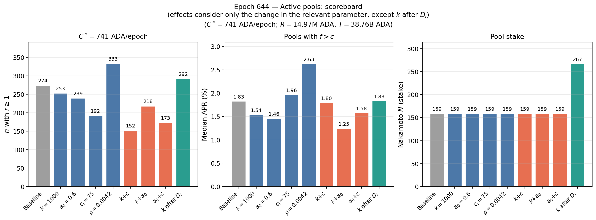
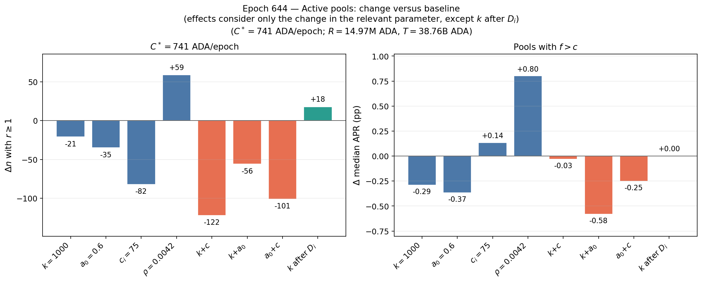
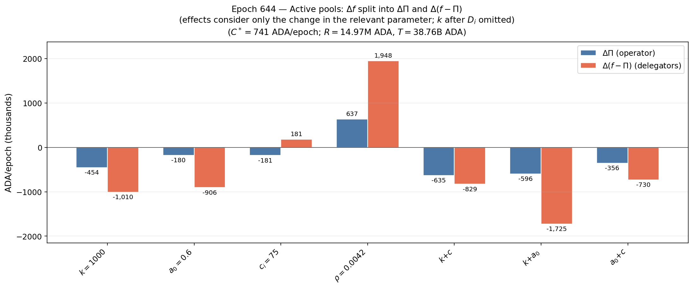
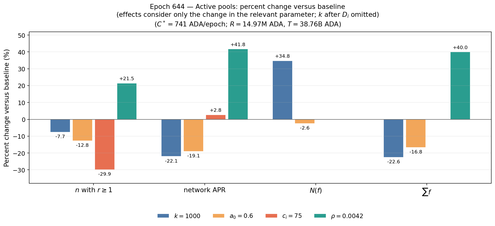
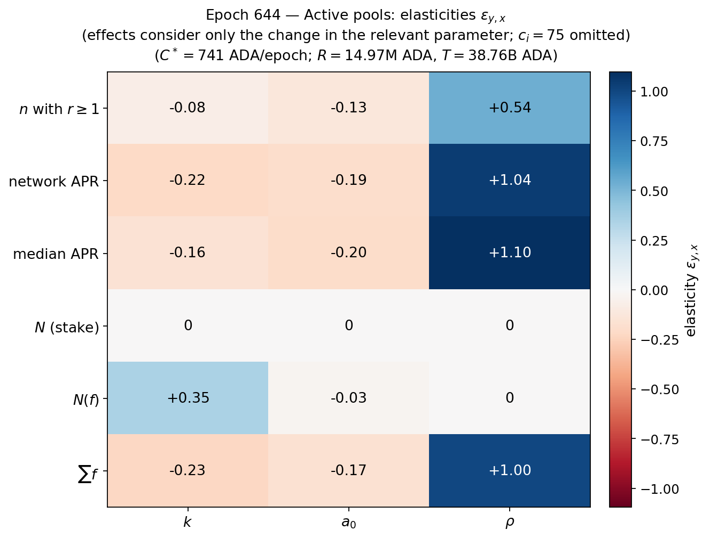

In this section, we compare the relative impacts of shocks across different parameters on key objectives, allowing us to identify the strongest drivers.

# Comparison of effects given the current state

In this subsection we compare the effects observed in the corresponding files. We use the epoch $644$ parameter shocks on **one sample** and **one operational cost**. The sample is the Active set of pools($n=1,262$), where and Inactive pool is one with $\sigma=0$ at epoch $644$, unmet pledge (active pledge below declared pledge) at epoch $644$, or zero blocks in the prior $15$ epochs. We consider $C^*=741.1$ ADA/epoch ($667$ USD/month at $0.15$ USD/ADA) as the operational cost (see XX), a reward pot $R=14,966,501.84$ ADA (except the $\rho$ column, which scales $R$ by $0.0042/0.003=1.4$), and a total supply $T=38,763,957,566.43$ ADA. 
The columns are:

- baseline: $k=500$, $a_0=0.3$, each pool's own declared $c_i$, $\rho=0.003$;
- $k=1000$;
- $a_0=0.6$;
- every declared $c_i$ set to $75$ ADA/epoch (this is **not** only a move in $c_{\min}$; it forces the declared cost of every Active pool);
- $\rho=0.0042$;
- the three two-way joints $k{+}c$, $k{+}a_0$, and $a_0{+}c$;
- $k=1000$ after the idealized $D_i$ reallocation used in the $k$ note (empty pools with $\sigma>40$ million ADA into higher-$D_i$ receivers, cap $40$ million ADA, $\lambda=1$, no ecosystem exit).

> The last column is the only one in which $\sigma$ moves. Frozen $\sigma$ does not change the pool-stake Nakamoto coefficient $N$; $c_i$ does not enter $f$, so $\sum\Delta f=0$ under $c_i=75$ and the change is a transfer between $\Pi$ and $f-\Pi$. A pool is counted as $r\ge 1$ when operator reward $\Pi$ covers $C^*$. Member APR is reported among pledge-met pools with $f>c$.

| Shock | $n$ ($\sigma>0$) | $n$ with $r\ge 1$ | $n$ with $r\ge 2$ | median $r$ | stake with $r\ge 1$ (B) | median APR | network APR | $n$ with $f>c$ | Nakamoto $N$ |
|:---|---:|---:|---:|---:|---:|---:|---:|---:|---:|
| Baseline | $1,262$ | $274$ | $125$ | $0.483$ | $11.91$ | $1.83\%$ | $1.66\%$ | $927$ | $159$ |
| $k=1000$ | $1,262$ | $253$ | $109$ | $0.480$ | $10.57$ | $1.54\%$ | $1.29\%$ | $927$ | $159$ |
| $a_0=0.6$ | $1,262$ | $239$ | $108$ | $0.470$ | $10.81$ | $1.46\%$ | $1.34\%$ | $884$ | $159$ |
| $c_i=75$ | $1,262$ | $192$ | $118$ | $0.171$ | $8.75$ | $1.96\%$ | $1.71\%$ | $1,118$ | $159$ |
| $\rho=0.0042$ | $1,262$ | $333$ | $170$ | $0.512$ | $13.72$ | $2.63\%$ | $2.35\%$ | $975$ | $159$ |
| $k=1000$, $c_i=75$ | $1,262$ | $152$ | $106$ | $0.170$ | $6.02$ | $1.80\%$ | $1.34\%$ | $1,118$ | $159$ |
| $k=1000$, $a_0=0.6$ | $1,262$ | $218$ | $100$ | $0.468$ | $9.39$ | $1.25\%$ | $1.04\%$ | $884$ | $159$ |
| $a_0=0.6$, $c_i=75$ | $1,262$ | $173$ | $104$ | $0.156$ | $7.93$ | $1.58\%$ | $1.39\%$ | $1,096$ | $159$ |
| $k=1000$ after $D_i$ | $1,052$ | $227$ | $68$ | $0.472$ | $7.45$ | $1.97\%$ | $1.88\%$ | $717$ | $267$ |

| Shock | $\Delta(n$ with $r\ge 1)$ | $\Delta(n$ with $r\ge 2)$ | $\Delta$ median APR (pp) | $\Delta$ network APR (pp) | $\Delta N$ | $\sum\Delta f$ | $\sum\Delta\Pi$ | $\sum\Delta(f-\Pi)$ |
|:---|---:|---:|---:|---:|---:|---:|---:|---:|
| $k=1000$ | $-21$ | $-16$ | $-0.29$ | $-0.37$ | $0$ | $-1,463,591$ | $-453,971$ | $-1,009,619$ |
| $a_0=0.6$ | $-35$ | $-17$ | $-0.37$ | $-0.32$ | $0$ | $-1,085,986$ | $-180,128$ | $-905,858$ |
| $c_i=75$ | $-82$ | $-7$ | $+0.14$ | $+0.05$ | $0$ | $0$ | $-180,935$ | $180,935$ |
| $\rho=0.0042$ | $+59$ | $+45$ | $+0.80$ | $+0.69$ | $0$ | $2,585,033$ | $637,038$ | $1,947,995$ |
| $k=1000$, $c_i=75$ | $-122$ | $-19$ | $-0.03$ | $-0.32$ | $0$ | $-1,463,591$ | $-634,909$ | $-828,681$ |
| $k=1000$, $a_0=0.6$ | $-56$ | $-25$ | $-0.58$ | $-0.62$ | $0$ | $-2,321,080$ | $-596,496$ | $-1,724,584$ |
| $a_0=0.6$, $c_i=75$ | $-101$ | $-21$ | $-0.25$ | $-0.27$ | $0$ | $-1,085,986$ | $-355,704$ | $-730,282$ |
| $k=1000$ after $D_i$ | $-47$ | $-57$ | $+0.15$ | $+0.22$ | $+108$ | $-306,075$ | $-1,049,789$ | $743,714$ |

### Description of results

Individually, most of results are intuitive. Most interesting is the comparison among the different shocks. However, these comparisons must be take carefully since the shocks may not be equivalent. We will go back to this point later in another subsection. We now bring a description of the previous plots.

Among the four single-parameter columns, **only** $\rho=0.0042$ raises both the count with $r\ge 1$ ($274\to 333$) and member APRs (median $1.83\%\to 2.63\%$, network $1.66\%\to 2.35\%$). It is also the only single shock with $\sum\Delta f>0$ ($\sum\Delta f=2,585,033$). Operators receive $24.6\%$ of that extra ADA ($\sum\Delta\Pi=637,038$); the rest is $f-\Pi$. The expansion in $n$ with $f>c$ is modest ($927\to 975$): most of the extra $f$ lands in pools that already cleared $c$.

The other three singles cut the count with $r\ge 1$, but they do not do the same thing.

- $c_i=75$ is the largest single cut in that count ($274\to 192$, $\Delta=-82$) and in median $r$ ($0.483\to 0.171$). Because $c$ does not enter $f$, $\sum\Delta f=0$ and $\sum\Delta\Pi=-180,935=-\sum\Delta(f-\Pi)$. More pools have $f>c$ ($927\to 1,118$), so the APR sample is not the same $927$ pools; median APR among $f>c$ rises to $1.96\%$. That is a transfer plus a change in who is in the APR set, not a larger pie.
- $k=1000$ cuts the count with $r\ge 1$ only to $253$ ($\Delta=-21$), but it is the larger single cut in **network** APR ($-0.37$ pp, to $1.29\%$). Newly oversaturated pools ($n=214$, $E(k)=4.81$ billion ADA above $z_0$) account for almost all of $\sum\Delta f=-1,463,591$. The count with $f>c$ stays $927$: $k$ does not move $c$, and the pools that already had $f\le c$ are not the ones saturating. Operators receive $31.0\%$ of the lost $f$ ($\sum\Delta\Pi=-453,971$).
- $a_0=0.6$ hits the whole sample through $f(\sigma,p;a_0)$, not only the newly oversaturated tail. The count with $r\ge 1$ falls to $239$ ($\Delta=-35$); $n$ with $f>c$ falls to $884$; median APR falls to $1.46\%$. $\sum\Delta f=-1,085,986$, of which operators take $16.6\%$ ($\sum\Delta\Pi=-180,128$). Stake Nakamoto $N$ is $159$ in every frozen-$\sigma$ column.

The joints are not sums of the singles.

- $k{+}c$ has the fewest pools with $r\ge 1$ ($152$). $\sum\Delta f$ equals the $k$ column ($-1,463,591$); $c$ only reallocates that $f$. $\sum\Delta\Pi=-634,909$ is the $k$ operator loss plus the $c$ transfer. Median APR is almost unchanged ($-0.03$ pp) because the two singles move it in opposite directions; network APR still falls $0.32$ pp.
- $k{+}a_0$ is the worst frozen-$\sigma$ column for APRs (median $1.25\%$, network $1.04\%$) and for $|\sum\Delta f|$ ($\sum\Delta f=-2,321,080$). That joint cut is **smaller** than the sum of the isolated $k$ and $a_0$ cuts ($1,463,591+1,085,986=2,549,577$): the two $f$-shocks overlap on the same pools. Operators receive $25.7\%$ of the joint $\Delta f$.
- $a_0{+}c$ inherits $\sum\Delta f$ from $a_0$ ($-1,085,986$). $\sum\Delta\Pi=-355,704$ is more negative than $a_0$ alone by about the $c$ transfer. The count with $r\ge 1$ is $173$.

Regarding the result after redelegation following desirability rank ($D_i$ after $k=1000$).

- The last column is not a frozen-$\sigma$ parameter shock. It takes $k=1000$ and moves snapshot stake under the $D_i$ rule of the $k$ note. Two hundred ten donors are emptied, so $n$ with $\sigma>0$ is $1,052$. Median APR among remaining $f>c$ is $1.97\%$ and network APR is $1.88\%$ — both **above** the $k=500$ baseline. Nakamoto $N$ rises from $159$ to $267$. The count with $r\ge 1$ is $227$, still below $274$: covering large pools are among the emptied donors, and receivers are filled only to $40$ million ADA. Relative to baseline, $\sum\Delta f=-306,075$: most of the frozen $k=1000$ cut of $1,463,591$ is recovered once stake leaves the cap. Operators as a group still lose ($\sum\Delta\Pi=-1,049,789$) because emptied pools take $\Pi$ to zero; remaining $f-\Pi$ rises ($\sum\Delta(f-\Pi)=743,714$).

### Relative impacts: finite differences and elasticities

The scoreboard shocks are not the same size. $k$ and $a_0$ double ($500\to 1000$, $0.3\to 0.6$), $\rho$ rises $40\%$ ($0.003\to 0.0042$), and $c_i=75$ is a **vector** shock: every declared cost is forced to $75$ ADA/epoch (median declared $c_i$ is $340$; every Active pool has $c_i>75$). It is not a move in $c_{\min}$, so there is no scalar $x$ and no elasticity for that column.

The objectives used here are:

- **Pool viability:** $n$ with $r\ge 1$ (operator reward covers $C^*$).
- **Delegator APR:** network APR (stake-weighted among pledge-met pools with $f>c$), and median APR as the typical such pool.
- **Decentralization of stake:** Nakamoto $N$ computed from pool $\sigma$. At frozen $\sigma$ this object cannot move.
- **Decentralization of rewards:** Nakamoto $N(f)$ computed from gross pool rewards. This can move when $f$ is reshaped even if $\sigma$ is frozen. $\rho$ scales $f$ and therefore leaves $N(f)$ unchanged; $c_i$ does not enter $f$.
- **Size of the reward pie:** $\sum f$. Holding $\tau$ and $Q$, $f$ is linear in $\rho$, so $\varepsilon_{\sum f,\rho}=1$ exactly.

Operator surplus $\sum\Pi$ is incidence (already in the $\Delta f$ split), not a separate headline objective. Treasury is a $\tau$ object. Splitting is a different exercise.

Finite differences $\Delta y$ answer what the paper shock does. Percent changes $\Delta y/y$ put those shocks in the units of the objective. Elasticities put the scalar levers in a common "% per %" unit:

$$
\varepsilon_{y,x}=\frac{(y'-y)/y}{(x'-x)/x},
$$

evaluated from the snapshot along the paper's discrete move $x\to x'$. This is not a derivative.

| Objective | $k=1000$ | $a_0=0.6$ | $c_i=75$ | $\rho=0.0042$ |
|:---|---:|---:|---:|---:|
| $n$ with $r\ge 1$ | $-7.7\%$ | $-12.8\%$ | $-29.9\%$ | $+21.5\%$ |
| network APR | $-22.1\%$ | $-19.1\%$ | $+2.8\%$ | $+41.8\%$ |
| median APR | $-15.9\%$ | $-20.1\%$ | $+7.4\%$ | $+43.8\%$ |
| $N$ (stake) | $0$ | $0$ | $0$ | $0$ |
| $N(f)$ | $+34.8\%$ | $-2.6\%$ | $0$ | $0$ |
| $\sum f$ | $-22.6\%$ | $-16.8\%$ | $0$ | $+40.0\%$ |

| Objective | $k=1000$ | $a_0=0.6$ | $c_i=75$ | $\rho=0.0042$ |
|:---|---:|---:|---:|---:|
| $n$ with $r\ge 1$ | $-21$ | $-35$ | $-82$ | $+59$ |
| network APR | $-0.37$ pp | $-0.32$ pp | $+0.05$ pp | $+0.69$ pp |
| median APR | $-0.29$ pp | $-0.37$ pp | $+0.14$ pp | $+0.80$ pp |
| $N$ (stake) | $0$ | $0$ | $0$ | $0$ |
| $N(f)$ | $+54$ | $-4$ | $0$ | $0$ |
| $\sum f$ | $-1,463,591$ | $-1,085,986$ | $0$ | $+2,585,033$ |

| Objective | $\varepsilon_{\cdot,k}$ | $\varepsilon_{\cdot,a_0}$ | $\varepsilon_{\cdot,\rho}$ |
|:---|---:|---:|---:|
| $n$ with $r\ge 1$ | $-0.08$ | $-0.13$ | $+0.54$ |
| network APR | $-0.22$ | $-0.19$ | $+1.04$ |
| median APR | $-0.16$ | $-0.20$ | $+1.10$ |
| $N$ (stake) | $0$ | $0$ | $0$ |
| $N(f)$ | $+0.35$ | $-0.03$ | $0$ |
| $\sum f$ | $-0.23$ | $-0.17$ | $+1.00$ |

Among the **scalar protocol parameters** $\{k,a_0,\rho\}$, the strongest driver depends on the objective.

- **Viability.** $\rho$ is the strongest ($\varepsilon=+0.54$). $a_0$ is next ($\varepsilon=-0.13$), then $k$ ($\varepsilon=-0.08$). In finite differences, however, $c_i=75$ is the largest cut ($-82$ pools, $-29.9\%$). That ranking cannot be turned into an elasticity: the shock is not a percent move in a protocol parameter.
- **Delegator APR.** $\rho$ again dominates ($\varepsilon=+1.04$ network, $+1.10$ median). The extra $f$ raises $\max\{f-c,0\}$ more than one-for-one when $c>0$, so the APR elasticities exceed $1$. $k$ and $a_0$ are similar in magnitude and both negative. $k$ is the stronger cut in **network** APR ($-22.1\%$ vs $-19.1\%$): it hits large, newly oversaturated pools. $a_0$ is the stronger cut in **median** APR ($-20.1\%$ vs $-15.9\%$): it compresses $f$ across the sample. $c_i=75$ raises APR slightly ($+2.8\%$ network) by a transfer and by changing who is in the $f>c$ set, not by enlarging $f$.
- **Stake decentralization.** All three elasticities of $N$ (stake) are $0$. Frozen $\sigma$ cannot change a stake-based Nakamoto coefficient. The only scoreboard movement in $N$ is the after-$D_i$ column ($159\to 267$).
- **Reward decentralization.** $k$ is the only material driver: $N(f)$ rises from $155$ to $209$ ($\varepsilon=+0.35$) because newly oversaturated pools lose $f$ and the reward pie is less concentrated. $a_0$ slightly *lowers* $N(f)$ ($-4$, $\varepsilon=-0.03$). $\rho$ and $c_i$ leave $N(f)$ unchanged. Operator-reward Nakamoto $N(\Pi)$ is much more concentrated than $N(f)$ (baseline $38$ vs $155$); $k$ raises it as well ($38\to 54$).
- **Reward pie.** $\varepsilon_{\sum f,\rho}=1$ by construction. $k$ compresses $\sum f$ more than $a_0$ ($-22.6\%$ vs $-16.8\%$). $c_i$ does not enter $f$.

Joints are omitted from the elasticities: two coordinates move, so there is no single $x$. Their finite differences remain in the scoreboard. The after-$D_i$ column is omitted for the same reason $\sigma$ is not a protocol parameter.

