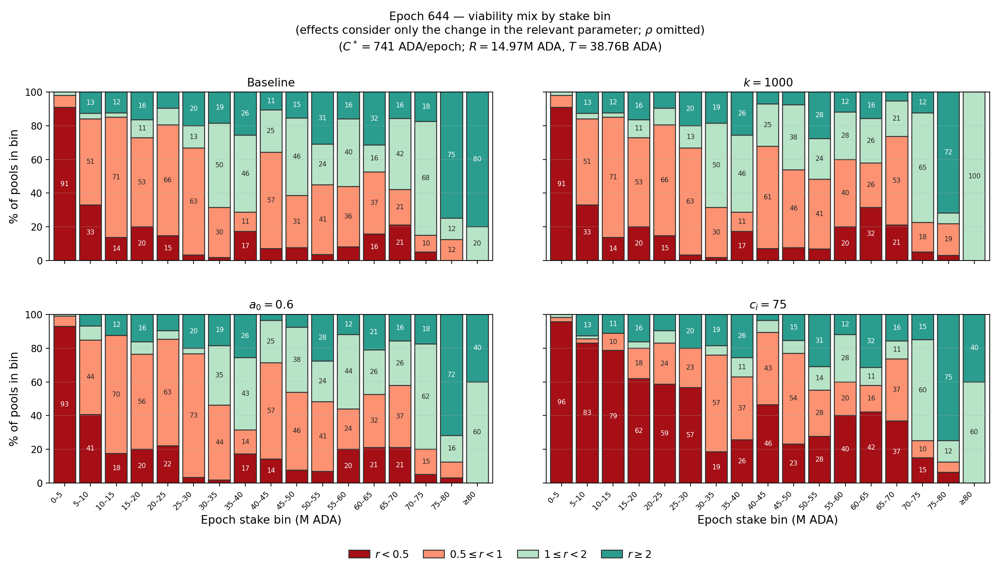
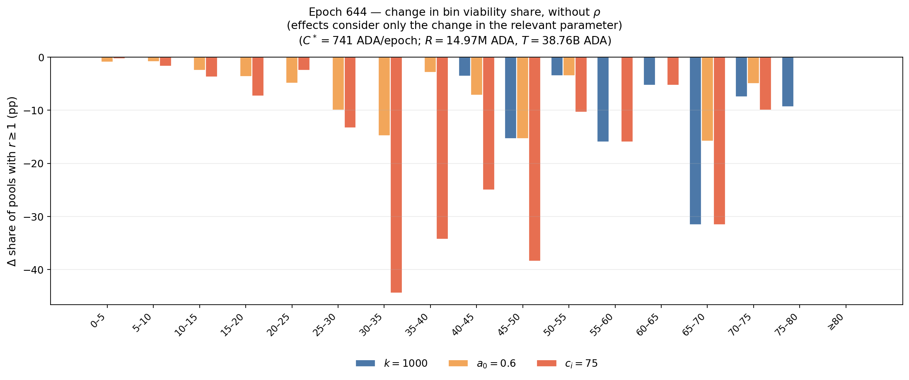
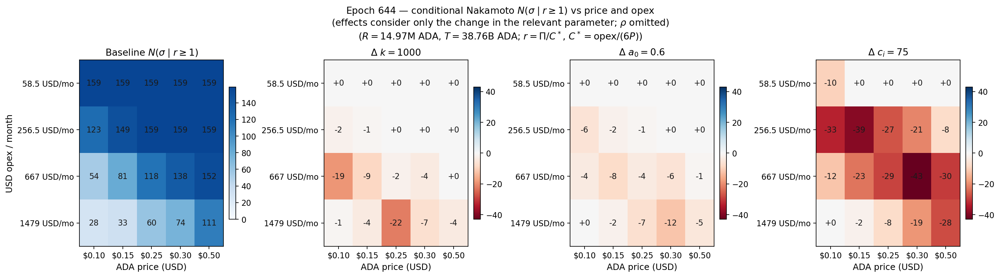

In this section, we compare the relative impacts of shocks across different parameters on key objectives, allowing us to identify the strongest drivers.

# Comparison of effects given the current state

In this subsection we compare the effects observed in the corresponding files. We use the epoch $644$ parameter shocks on **one sample** and **one operational cost**. The sample is the Active set of pools($n=1,262$), where and Inactive pool is one with $\sigma=0$ at epoch $644$, unmet pledge (active pledge below declared pledge) at epoch $644$, or zero blocks in the prior $15$ epochs. We consider $C^\*=741.1$ ADA/epoch ($667$ USD/month at $0.15$ USD/ADA) as the operational cost (see [Lopez de Lara (2026)](https://input-output-hk.github.io/spo-incentives/pdf-viewer.html?file=references/previous-analasys/spo-incentives-analysis_lopez-de-lara_2025.pdf))), a reward pot $R=14,966,501.84$ ADA (except the $\rho$ column, which scales $R$ by $0.0042/0.003=1.4$), and a total supply $T=38,763,957,566.43$ ADA. 
The columns are:

- baseline: $k=500$, $a_0=0.3$, each pool's own declared $c_i$, $\rho=0.003$;
- $k=1000$;
- $a_0=0.6$;
- every declared $c_i$ set to $75$ ADA/epoch (this is **not** only a move in $c_{\min}$; it forces the declared cost of every Active pool);
- $\rho=0.0042$;
- the three two-way joints $k{+}c$, $k{+}a_0$, and $a_0{+}c$;
- $k=1000$ after the idealized $D_i$ reallocation used in the $k$ note (only $\sigma-40$ million ADA leaves pools with $\sigma>40$ million ADA into higher-$D_i$ receivers; donors keep $40$ million ADA; $\lambda=1$, no ecosystem exit).

> The last column is the only one in which $\sigma$ moves. Frozen $\sigma$ does not change the pool-stake Nakamoto coefficient $N$; $c_i$ does not enter $f$, so $\sum\Delta f=0$ under $c_i=75$ and the change is a transfer between $\Pi$ and $f-\Pi$. A pool is counted as $r\ge 1$ when operator reward $\Pi$ covers $C^*$. Member APR is reported among pledge-met pools with $f>c$.

| Shock | $n$ ($\sigma>0$) | $n$ with $r\ge 1$ | $n$ with $r\ge 2$ | median $r$ | stake with $r\ge 1$ (B) | median APR | network APR | $n$ with $f>c$ | Nakamoto $N$ |
|:---|---:|---:|---:|---:|---:|---:|---:|---:|---:|
| Baseline | $1,262$ | $274$ | $125$ | $0.483$ | $11.91$ | $1.83\%$ | $1.66\%$ | $927$ | $159$ |
| $k=1000$ | $1,262$ | $253$ | $109$ | $0.480$ | $10.57$ | $1.54\%$ | $1.29\%$ | $927$ | $159$ |
| $a_0=0.6$ | $1,262$ | $239$ | $108$ | $0.470$ | $10.81$ | $1.46\%$ | $1.34\%$ | $884$ | $159$ |
| $c_i=75$ | $1,262$ | $192$ | $118$ | $0.171$ | $8.75$ | $1.96\%$ | $1.71\%$ | $1,118$ | $159$ |
| $\rho=0.0042$ | $1,262$ | $333$ | $170$ | $0.512$ | $13.72$ | $2.63\%$ | $2.35\%$ | $975$ | $159$ |
| $k=1000$, $c_i=75$ | $1,262$ | $152$ | $106$ | $0.170$ | $6.02$ | $1.80\%$ | $1.34\%$ | $1,118$ | $159$ |
| $k=1000$, $a_0=0.6$ | $1,262$ | $218$ | $100$ | $0.468$ | $9.39$ | $1.25\%$ | $1.04\%$ | $884$ | $159$ |
| $a_0=0.6$, $c_i=75$ | $1,262$ | $173$ | $104$ | $0.156$ | $7.93$ | $1.58\%$ | $1.39\%$ | $1,096$ | $159$ |
| $k=1000$ after $D_i$ | $1,262$ | $292$ | $111$ | $0.487$ | $9.81$ | $1.83\%$ | $1.72\%$ | $927$ | $267$ |

| Shock | $\Delta(n$ with $r\ge 1)$ | $\Delta(n$ with $r\ge 2)$ | $\Delta$ median APR (pp) | $\Delta$ network APR (pp) | $\Delta N$ | $\sum\Delta f$ | $\sum\Delta\Pi$ | $\sum\Delta(f-\Pi)$ |
|:---|---:|---:|---:|---:|---:|---:|---:|---:|
| $k=1000$ | $-21$ | $-16$ | $-0.29$ | $-0.37$ | $0$ | $-1,463,591$ | $-453,971$ | $-1,009,619$ |
| $a_0=0.6$ | $-35$ | $-17$ | $-0.37$ | $-0.32$ | $0$ | $-1,085,986$ | $-180,128$ | $-905,858$ |
| $c_i=75$ | $-82$ | $-7$ | $+0.14$ | $+0.05$ | $0$ | $0$ | $-180,935$ | $180,935$ |
| $\rho=0.0042$ | $+59$ | $+45$ | $+0.80$ | $+0.69$ | $0$ | $2,585,033$ | $637,038$ | $1,947,995$ |
| $k=1000$, $c_i=75$ | $-122$ | $-19$ | $-0.03$ | $-0.32$ | $0$ | $-1,463,591$ | $-634,909$ | $-828,681$ |
| $k=1000$, $a_0=0.6$ | $-56$ | $-25$ | $-0.58$ | $-0.62$ | $0$ | $-2,321,080$ | $-596,496$ | $-1,724,584$ |
| $a_0=0.6$, $c_i=75$ | $-101$ | $-21$ | $-0.25$ | $-0.27$ | $0$ | $-1,085,986$ | $-355,704$ | $-730,282$ |
| $k=1000$ after $D_i$ | $+18$ | $-14$ | $+0.00$ | $+0.06$ | $+108$ | $-201,743$ | $-407,352$ | $205,609$ |

#### Description of results

Individually, most of results are intuitive. Most interesting is the comparison among the different shocks. However, these comparisons must be take carefully since the shocks may not be equivalent. We will go back to this point later in another subsection. We now bring a description of the previous plots.

Among the four single-parameter columns, **only** $\rho=0.0042$ raises both the count with $r\ge 1$ ($274\to 333$) and member APRs (median $1.83\%\to 2.63\%$, network $1.66\%\to 2.35\%$). It is also the only single shock with $\sum\Delta f>0$ ($\sum\Delta f=2,585,033$). Operators receive $24.6\%$ of that extra ADA ($\sum\Delta\Pi=637,038$); the rest is $f-\Pi$. The expansion in $n$ with $f>c$ is modest ($927\to 975$): most of the extra $f$ lands in pools that already cleared $c$.

The other three singles cut the count with $r\ge 1$, but they do not do the same thing.

- $c_i=75$ is the largest single cut in that count ($274\to 192$, $\Delta=-82$) and in median $r$ ($0.483\to 0.171$). Because $c$ does not enter $f$, $\sum\Delta f=0$ and $\sum\Delta\Pi=-180,935=-\sum\Delta(f-\Pi)$. More pools have $f>c$ ($927\to 1,118$), so the APR sample is not the same $927$ pools; median APR among $f>c$ rises to $1.96\%$. That is a transfer plus a change in who is in the APR set, not a larger pie.
- $k=1000$ cuts the count with $r\ge 1$ only to $253$ ($\Delta=-21$), but it is the larger single cut in **network** APR ($-0.37$ pp, to $1.29\%$). Newly oversaturated pools ($n=214$, $E(k)=4.81$ billion ADA above $z_0$) account for almost all of $\sum\Delta f=-1,463,591$. The count with $f>c$ stays $927$: $k$ does not move $c$, and the pools that already had $f\le c$ are not the ones saturating. Operators receive $31.0\%$ of the lost $f$ ($\sum\Delta\Pi=-453,971$).
- $a_0=0.6$ hits the whole sample through $f(\sigma,p;a_0)$, not only the newly oversaturated tail. The count with $r\ge 1$ falls to $239$ ($\Delta=-35$); $n$ with $f>c$ falls to $884$; median APR falls to $1.46\%$. $\sum\Delta f=-1,085,986$, of which operators take $16.6\%$ ($\sum\Delta\Pi=-180,128$). Stake Nakamoto $N$ is $159$ in every frozen-$\sigma$ column.

The joints are not sums of the singles.

- $k{+}c$ has the fewest pools with $r\ge 1$ ($152$). $\sum\Delta f$ equals the $k$ column ($-1,463,591$); $c$ only reallocates that $f$. $\sum\Delta\Pi=-634,909$ is the $k$ operator loss plus the $c$ transfer. Median APR is almost unchanged ($-0.03$ pp) because the two singles move it in opposite directions; network APR still falls $0.32$ pp.
- $k{+}a_0$ is the worst frozen-$\sigma$ column for APRs (median $1.25\%$, network $1.04\%$) and for $|\sum\Delta f|$ ($\sum\Delta f=-2,321,080$). That joint cut is **smaller** than the sum of the isolated $k$ and $a_0$ cuts ($1,463,591+1,085,986=2,549,577$): the two $f$-shocks overlap on the same pools. Operators receive $25.7\%$ of the joint $\Delta f$.
- $a_0{+}c$ inherits $\sum\Delta f$ from $a_0$ ($-1,085,986$). $\sum\Delta\Pi=-355,704$ is more negative than $a_0$ alone by about the $c$ transfer. The count with $r\ge 1$ is $173$.

Regarding the result after redelegation following desirability rank ($D_i$ after $k=1000$).

- The last column is not a frozen-$\sigma$ parameter shock. It takes $k=1000$ and moves only the excess above $40$ million ADA under the $D_i$ rule of the $k$ note. The $210$ donors remain at $40$ million ADA, so $n$ with $\sigma>0$ stays $1,262$. Median APR among pools with $f>c$ is $1.83\%$ — the same as baseline — and network APR is $1.72\%$, slightly above $1.66\%$. Nakamoto $N$ rises from $159$ to $267$. The count with $r\ge 1$ is $292$, above $274$: donors keep enough stake to cover $C^\*$, and some receivers grow into $r\ge 1$. Relative to baseline, $\sum\Delta f=-201,743$: most of the frozen $k=1000$ cut of $1,463,591$ is recovered once the excess leaves the cap. Operators as a group still lose ($\sum\Delta\Pi=-407,352$); $f-\Pi$ rises ($\sum\Delta(f-\Pi)=205,609$).

### Relative impacts: finite differences and elasticities

The previous shocks are not the same size and hence, not comparable to measure what shock is most efficient in achieving a certain goal. We aim to facilitate that comparison in this subsection. We first define the key objectives to measure the effectivenes of the shocks. The objectives used are:

- **Pool viability:** number of pools $n$ with $r\ge 1$ (operator reward covers $C^*$).
- **Delegator APR:** network APR (stake-weighted among active pools with $f>c$), and median APR as the typical such pool.
- **Decentralization of stake:** Nakamoto coefficient $N$ computed: 

$$N=N(\sigma)=\min\\{n:\sum_{i=1}^{n}\sigma_{(i)}\ge \frac{1}{2}\sum_j\sigma_j\\}.$$

Notice that if we do not assume a redelgation, this object does not move. We keep it for completeness. 
- **Decentralization of rewards:** Nakamoto coefficient $N(f)$ computed from gross pool rewards. This can move when $f$ is reshaped even if stakes do not change.

$$N(f)=\min\\{n:\sum_{i=1}^{n}f_{(i)}\ge \frac{1}{2}\sum_j f_j\\},$$

  with $f_{(1)}\ge f_{(2)}\ge\cdots$. A larger $N(f)$ means more pools are needed to assemble half of $\sum f$. This can move when $f$ is reshaped even if the distribution of $\sigma$ does not change.
- **Size of the reward pie:** $\sum f$.

We next study finite differences $\Delta y$, answering what the shock does, percent changes $\Delta y/y$ that put those shocks in the units of the objective, and elasticities put the scalar levers in a common "% per %" unit:

$$
\varepsilon_{y,x}=\frac{(y'-y)/y}{(x'-x)/x},
$$

evaluated with epoch 644 data.

Percent change versus baseline ($\Delta y/y$):

| Objective | $k=1000$ | $a_0=0.6$ | $c_i=75$ | $\rho=0.0042$ |
|:---|---:|---:|---:|---:|
| $n$ with $r\ge 1$ | $-7.7\%$ | $-12.8\%$ | $-29.9\%$ | $+21.5\%$ |
| network APR | $-22.1\%$ | $-19.1\%$ | $+2.8\%$ | $+41.8\%$ |
| median APR | $-15.9\%$ | $-20.1\%$ | $+7.4\%$ | $+43.8\%$ |
| $N$ (stake) | $0$ | $0$ | $0$ | $0$ |
| $N(f)$ | $+34.8\%$ | $-2.6\%$ | $0$ | $0$ |
| $\sum f$ | $-22.6\%$ | $-16.8\%$ | $0$ | $+40.0\%$ |

Finite difference versus baseline ($\Delta y$):

| Objective | $k=1000$ | $a_0=0.6$ | $c_i=75$ | $\rho=0.0042$ |
|:---|---:|---:|---:|---:|
| $n$ with $r\ge 1$ | $-21$ | $-35$ | $-82$ | $+59$ |
| network APR | $-0.37$ pp | $-0.32$ pp | $+0.05$ pp | $+0.69$ pp |
| median APR | $-0.29$ pp | $-0.37$ pp | $+0.14$ pp | $+0.80$ pp |
| $N$ (stake) | $0$ | $0$ | $0$ | $0$ |
| $N(f)$ | $+54$ | $-4$ | $0$ | $0$ |
| $\sum f$ | $-1,463,591$ | $-1,085,986$ | $0$ | $+2,585,033$ |

Elasticity ($\varepsilon_{y,x}$): 

| Objective | $\varepsilon_{\cdot,k}$ | $\varepsilon_{\cdot,a_0}$ | $\varepsilon_{\cdot,\rho}$ |
|:---|---:|---:|---:|
| $n$ with $r\ge 1$ | $-0.08$ | $-0.13$ | $+0.54$ |
| network APR | $-0.22$ | $-0.19$ | $+1.04$ |
| median APR | $-0.16$ | $-0.20$ | $+1.10$ |
| $N$ (stake) | $0$ | $0$ | $0$ |
| $N(f)$ | $+0.35$ | $-0.03$ | $0$ |
| $\sum f$ | $-0.23$ | $-0.17$ | $+1.00$ |

Among the **protocol parameters** $\{k,a_0,\rho\}$, the strongest driver depends on the objective.

- **Viability.** $\rho$ is the only scalar lever that raises $n$ with $r\ge 1$ ($\varepsilon=+0.54$). Among the other parameters, $k$ and $a_0$ both cut it; $k$ is less harmful ($\varepsilon=-0.08$) than $a_0$ ($\varepsilon=-0.13$). In finite differences, however, $c_i=75$ is the largest cut ($-82$ pools, $-29.9\%$).
- **Delegator APR.** Again, $\rho$ is the only scalar lever that raises member APR ($\varepsilon=+1.04$ network, $+1.10$ median). The extra $f$ raises $\max\{f-c,0\}$ more than one-for-one when $c>0$, so those elasticities exceed $1$. Among the other parameters, $k$ and $a_0$ both cut APR. For **network** APR, $a_0$ is less harmful ($\varepsilon=-0.19$) than $k$ ($\varepsilon=-0.22$): $k$ hits large, newly oversaturated pools. For **median** APR, $k$ is less harmful ($\varepsilon=-0.16$) than $a_0$ ($\varepsilon=-0.20$): $a_0$ compresses $f$ across the sample. In finite differences, $c_i=75$ raises APR slightly ($+2.8\%$ network) by a transfer and by changing who is in the $f>c$ set, not by enlarging $f$.
- **Stake decentralization.** None of the scalar levers moves $N$ (stake): all three elasticities are $0$. 
- **Reward decentralization.** $N(f)$ is the Nakamoto coefficient of $f$: the smallest number of pools whose combined gross rewards are at least half of $\sum f$. $k$ is the only scalar lever that raises it ($155\to 209$, $\varepsilon=+0.35$): newly oversaturated pools lose $f$, so more pools are needed to assemble half of the pie. Among the other parameters, $a_0$ cuts it slightly ($\varepsilon=-0.03$); $\rho$ leaves $N(f)$ unchanged (it scales $f$).  The same coefficient on operator rewards, $N(\Pi)$, is much more concentrated (baseline $38$ vs $N(f)=155$); $k$ raises it as well ($38\to 54, $\varepsilon=+0.42$). For comparison, $c_i=75$ leaves $N(f)$ unchanged and lowers $N(\Pi)$ ($38\to 32$).
- **Reward pie.** $\rho$ is the only scalar lever that raises $\sum f$ ($\varepsilon=+1$ by construction). Among the other parameters, $k$ and $a_0$ both compress it; $a_0$ is less harmful ($\varepsilon=-0.17$) than $k$ ($\varepsilon=-0.23$). In finite differences, $c_i=75$ does not move $\sum f$: $c$ does not enter $f$.

#### Viability by stake bin

In this case, we consider the viability objective for different groups of pools (grouped by size) instead of taking the whole set as before. The goal is to compare the effects of the different shocks for each group. The $5$ million ADA bins are the same as in the individual parameter notes. 

**Finite difference versus baseline ($\Delta n$ with $r\ge 1$)**

| Band | $n$ | Baseline $r\ge 1$ | $k=1000$ | $a_0=0.6$ | $c_i=75$ |
|:---|---:|---:|---:|---:|---:|
| $<10$M | $757$ | $32$ | $32$ ($0$) | $25$ ($-7$) | $28$ ($-4$) |
| $10$–$40$M | $295$ | $107$ | $107$ ($0$) | $89$ ($-18$) | $59$ ($-48$) |
| $\ge 40$M | $210$ | $135$ | $114$ ($-21$) | $125$ ($-10$) | $105$ ($-30$) |

**Elasticity of $n$ with $r\ge 1$ by band**

| Band | Baseline $r\ge 1$ | $\varepsilon_{\cdot,k}$ | $\varepsilon_{\cdot,a_0}$ | $c_i=75$ ($\Delta y/y$) |
|:---|---:|---:|---:|---:|
| $<10$M | $32$ | $0$ | $-0.22$ | $-12.5\%$ |
| $10$–$40$M | $107$ | $0$ | $-0.17$ | $-44.9\%$ |
| $\ge 40$M | $135$ | $-0.16$ | $-0.07$ | $-22.2\%$ |

#### Conditional Nakamoto

The Nakamoto coefficient $N$ does not change when there is not redistribution of stakes. Parameter shocks do not per-se make those redistributions, although they can induce a response of delegators. What parameter shocks do is to change the composition of particular sets of pools, i.e., **who is in the set**.

For a nonempty set of Active pools $A$, let $x_{(1)}^{A}\ge x_{(2)}^{A}\ge\cdots$ be the values of $x$ on $A$ in decreasing order, and

$$
N(x|A)=\min\\{ n:\sum_{i=1}^{n}x^A_{(i)}\geq \frac{1}{2}\sum_{j\in A}x_j \\}.
$$

Let $V=\{i:r_i\ge 1\}$ and $L=\{i:\sigma_i\ge 5\times 10^{6}\}$. Then, we check the following Conditional Nakamoto coefficients:

- $N(\sigma\mid r\ge 1)=N(\sigma\mid V)$: Nakamoto coefficient of stake **among pools with** $r\ge 1$ (majority of that subset's stake),

  $$N(\sigma\mid r\geq 1)=\min\\{n:\sum_{i=1}^{n}\sigma_{(i)}^{V}\geq \frac{1}{2}\sum_{j\in V}\sigma_j\\}.$$
  
- $N(\sigma\mid \sigma\ge 5\mathrm{M})=N(\sigma\mid L)$: the same coefficient among pools with at least $5$ million ADA,

  $$N(\sigma\mid \sigma\geq 5\mathrm{M})=\min\\{n:\sum_{i=1}^{n}\sigma_{(i)}^{L}\geq \frac{1}{2}\sum_{j\in L}\sigma_j\\}.$$
  
- $N$ of total via $r\ge 1$: among pools with $r\ge 1$, how many are needed to reach half of **all** Active stake,

  $$N^{\mathrm{tot}}(\sigma\mid r\geq 1)=\min\\{n:\sum_{i=1}^{n}\sigma_{(i)}^{V}\geq \frac{1}{2}\sum_{j}\sigma_j\\}$$
  
  if $\sum_{j\in V}\sigma_j\ge \frac{1}{2}\sum_{j}\sigma_j$, and undefined otherwise.

- $N(f\mid \sigma\ge 5\mathrm{M})=N(f\mid L)$: reward Nakamoto among the $\ge 5$ million ADA pools,

  $$N(f\mid \sigma\geq 5\mathrm{M})=\min\\{n:\sum_{i=1}^{n}f_{(i)}^{L}\geq \frac{1}{2}\sum_{j\in L}f_j\\}.$$

Using $C^\*=741.1$ ADA/epoch:

| Shock | $n$ with $r\ge 1$ | $N$ (Nakamoto Coefficient) | $N(\sigma\mid r\ge 1)$ | stake share $r\ge 1$ | $N$ of total via $r\ge 1$ | $N(\sigma\mid\sigma\ge 5\mathrm{M})$ | $N(f)$ | $N(f\mid\sigma\ge 5\mathrm{M})$ |
|:---|---:|---:|---:|---:|---:|---:|---:|---:|
| Baseline | $274$ | $159$ | $81$ | $55.9\%$ | $191$ | $152$ | $155$ | $147$ |
| $k=1000$ | $253$ | $159$ | $72$ | $49.6\%$ | — | $152$ | $209$ | $199$ |
| $a_0=0.6$ | $239$ | $159$ | $73$ | $50.7\%$ | $213$ | $152$ | $151$ | $143$ |
| $c_i=75$ | $192$ | $159$ | $58$ | $41.1\%$ | — | $152$ | $155$ | $147$ |
| $\rho=0.0042$ | $333$ | $159$ | $96$ | $64.4\%$ | $178$ | $152$ | $155$ | $147$ |

$N(\sigma\mid r\ge 1)$ **falls** under $k$, $a_0$, and $c_i=75$: dropping pools from the $r\ge 1$ set leaves a more concentrated viable group. $c_i=75$ is the largest drop ($81\to 58$), and viable pools then hold only $41.1\%$ of Active stake, so they cannot form a majority of the network (—). $k$ puts the viable share just under one half ($49.6\%$). $\rho$ raises $N(\sigma\mid r\ge 1)$ to $96$ and the viable share to $64.4\%$.

Across the price–opex grid, $N(\sigma\mid r\ge 1)$ approaches the unconditional $N=159$ when $C^\*$ is easy (high price, low opex): almost every Active pool has $r\ge 1$, so the restriction does not bind.

