# Incentive effects of changing `minPoolCost` ($c_{min}$)

## Summary: Trade-off from reducing minPoolCost.

Reducing minPoolCost is conditionally beneficial. The net effect depends on which policy objective is prioritized: operator competitiveness for delegators, operator viability, Sybil resistance, or decentralization.

**Pros**
1. Some pools that reduce declared fixed cost show higher delegator APR, improving their attractiveness for delegators
2. APR gains are stronger among fixed-cost reducers than in network-wide aggregates.

**Risks**
1. Operator viability can weaken after fixed-cost reductions. However, an operator can avoid reducing their fixed cost at the cost of losing competitiveness.
2. After minPoolCost was reduced, only a minority of Active pools reduced declared fixed cost or margin, so network-wide effects remained modest.
3. Whole-network concentration metrics may not improve even when reducer ones improve.

**What the evidence suggests** (based on previous change of `minPoolCost`)
1. Operator fixed-cost reduction was partial: only about $24.1%$ of Active pools.
2. Fixed-cost reducers had lower median stake than non-reducers, and higher median declared and active pledge.
3. Among reducers, a majority gained stake ($52.5\%$).
4. Among reducers, smaller ones are more likely to be gainers than larger reducers.
5. Combining fixed-cost and margin cuts was associated with better delegation outcomes than fixed-cost-only cuts. Among cost reducers, raising margin ($22.3%$) was more common than also cutting it ($10.0%$).
6. Whole-network concentration did not clearly improve (Nakamoto $N$ from $190$ to $185$; Agg. active pledge from $1.58\text{B}$ to $1.39\text{B}$ ADA).
7. Operator viability weakened after the cut (Cover OpEx from $827$ to $741$).

**Behavioral and equilibrium discussion** (theoretical exercises given the current snapshot)
1. Reducing `minPoolCost` raises desirability for pools that cut declared cost, which can shift stake toward those pools.
2. Many operators would not follow: they already declare above the floor, and cutting $340\to 170$ would reduce operator reward for most pools that currently earn it.
3. Pools already at the floor tend to be smaller and to post lower margins, so the competitive channel is concentrated among smaller pools.
4. Splitting raises operator revenue for a majority of pools. A lower declared cost makes more pools gain from splitting, but shrinks the typical extra reward.
5. If declared costs fell uniformly, median delegator APR would rise modestly while more operators would fail to cover OpEx.

**Policy interpretation**
1. Trade-off: lower minPoolCost can improve delegator APR while reducing operator viability.
2. If the primary objective is short-run small-pool competitiveness, a lower minPoolCost can help, but with a viability trade-off. This trade-off limits the capacity of small pools to follow the reduction.
3. If the primary objective is long-run decentralization, reducing minPoolCost in isolation is not clearly supportive.

## Parameter values at the current state
For the numerical analysis in this section, we use the parameter values below unless stated otherwise. These values may differ from the snapshot values reported in [Parameter-Landscape.md](../../Parameter-Landscape.md), because this comparative-statics exercise is anchored to a single reference state.

| Symbol | Parameter | Value |
| --- | --- | --- | 
| $R$ | Reward pot | $14.9M$ ADA| 
| $T$ | Total ADA supply | $38.8B$ ADA | 
| $k$ | Target number of stake pools | 500 | 
| $a_0$ | Pledge influence. | 0.3 | 
| $c_{min}$ | Minimum fixed cost (`minPoolCost`). | 170 ADA |
| $m_i$ | Operator margin/commission deducted from delegator rewards. | 5%  |
| $\rho$ | Reserve decay rate.  | 0.3%  |
| $\tau$ | Treasury share.| 20% |

## Design

The parameter `minPoolCost` (here also denoted as $c_{min}$) sets the minimum fixed cost that a stake pool operator may declare. The following plot shows the histogram of the fixed cost declarations at epoch 644.

  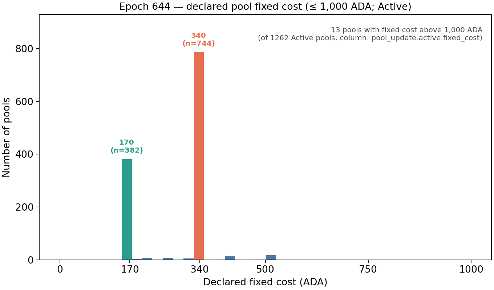

A change in $c_{min}$ or in the declared fixed cost $c_i$ does not affect the pool's gross reward. Instead, the declared fixed cost is paid to the operator before the remaining rewards are divided between the operator and delegators.

The main objective of $c_{min}$ is to support economically viable pool operation and provide some protection against Sybil attacks. Without a minimum fixed cost to declare, an operator could create many pools, declare negligible costs, and offer returns to delegators that other operators (that need to declare their cost) may be unable to match.

The main trade-off comes from the incentive that a pool has to declare a larger fixed cost to cover their actual cost versus to declare less to become more attractive for delegators. That is, a higher $c_{min}$ can therefore protect operator revenues and discourage small, undercapitalized Sybil pools, but it also reduces the competitiveness of small and new pools and may push delegation toward larger pools. A lower $c_{min}$ facilitates entry and improves small-pool returns, but may intensify competition in $c_i$ and make it easier for multi-pool operators to expand.

The appropriate level of $c_{min}$ therefore balances operator viability and Sybil resistance against entry, competition, and decentralization.

Next, this effect and trade-off are explained in more detail.

## Direct mechanical effects 
In this section we consider the direct effects of **reducing** `minPoolCost` while holding everything else equal (ceteris paribus). 

### Gross pool rewards

Let $\sigma_i$ denote the total delegation at pool $i$, $p_i$ the declared pledge of the pool, and $z_0$ the saturation threshold. The gross pool reward function is

$$f(\sigma_i,p_i) = \frac{R}{1+a_0} \left[ \tilde{\sigma}_i + a_0\tilde{p}_i \frac{\tilde{\sigma}_i-\tilde{p}_i\frac{z_0-\tilde{\sigma}_i}{z_0}}{z_0} \right], \qquad \tilde{\sigma}_i = \min\\{\sigma_i, z_0\\}, \qquad \tilde{p}_i = \min\\{p_i, z_0\\},$$

which does not depend on $c_{min}$.

> **Note:** Most of the analysis presented in this document assumes a static environment, omitting the dynamic, inter-epoch feedback effects of return flows to the reserves. While return flows can be evaluated statically for a given state, fully dynamic feedback scenarios will be explicitly indicated.

However, `minPoolCost` operates through two distinct channels: it guarantees fixed cost recovery for the operator while simultaneously dictating net delegator yield, thereby driving both operator profitability and pool competitiveness.

### Operator gross revenue

The pool operator gross revenue function is

$$\begin{cases} c_i + (f(\sigma_i,p_i)-c_i) \left[m_i +(1-m_i)\frac{\hat{p}_i}{\sigma_i}\right], & \text{if }  f(\sigma_i,p_i)>c_i, \\ 
f(\sigma_i,p_i), & \text{otherwise} \end{cases}$$

where $\hat{p}_i$ is the operator's active pledge (the stake/delegation owned by the operator).
    
Consider a reduction in `minPoolCost` and that the operator declares $c_i=$`minPoolCost`. Note that this assumption contrasts with [Brünjes et al. (2020)](../../References/papers/reward-sharing-schemes_brunjes-kiayias-et-al_2020.pdf) setting where there is incentive compatibility, i.e., each operator declares their actual cost. However, the heavy concentration at 340 and 170 ADA in the [histogram](#fig-min-pool-cost-644) suggests parameter inertia or active competitive optimization rather than truthful cost revelation.

The next plot shows the effect of a reduction in `minPoolCost` on pool operator gross reward.

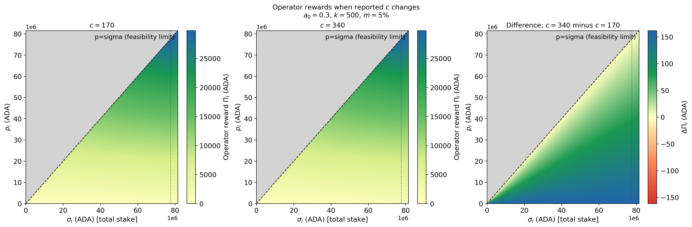

The plot shows that a reduction in the declared fixed cost (from $170$ ADA to $75$ ADA) reduces pool operator revenues, with the effect being particularly strong for small pools. This is because the fixed cost plays an important role in operators' revenues. To see this, take

$$
\Pi_i = c_i+(f(\sigma_i,p_i)-c_i)\underbrace{[m_i +(1-m_i)\frac{p_i}{\sigma_i}]}_{s\in[0,1]},
$$

Hence,

$$\Pi_i=sf(\sigma_i,p_i)+(1-s)c_i, \quad \text{and} \quad \partial \Pi_i/\partial c_i=(1-s)\geq 0.$$

It follows that the operator's profit drops with a lower $c_i$ (unless $p_i=\sigma_i=z_0$). A potential consequence is that very small pool operators will not have room to reduce their fixed costs without losing economic viability. 

### Delegator return per unit of stake

Reducing the fixed cost increases the net reward

$$(f(\sigma_i,p_i)-c_i),$$ 

that a pool can distribute among its delegators. The next plot illustrates this benefit by comparing the net rewards per unit of stake for different $c_i$, where net rewards per unit of stake are

$$\frac{\max\\{f(\sigma_i,p_i)-c_i,0\\}}{\sigma_i},$$

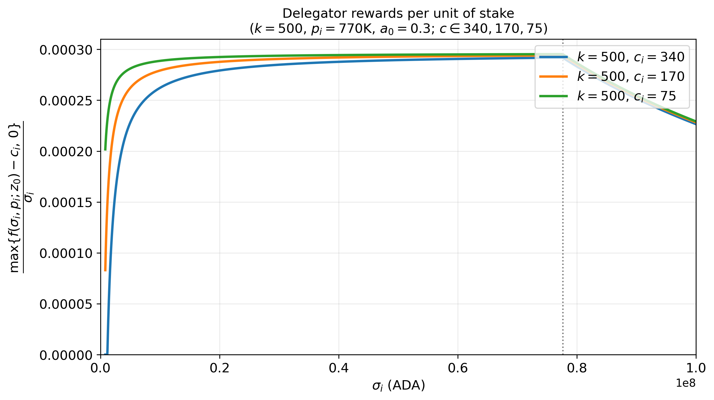

  
The plot suggests that cost reductions have a more significant positive impact on the competitiveness of small pools than on that of large ones. Nevertheless, large pools may still remain more attractive for delegators.

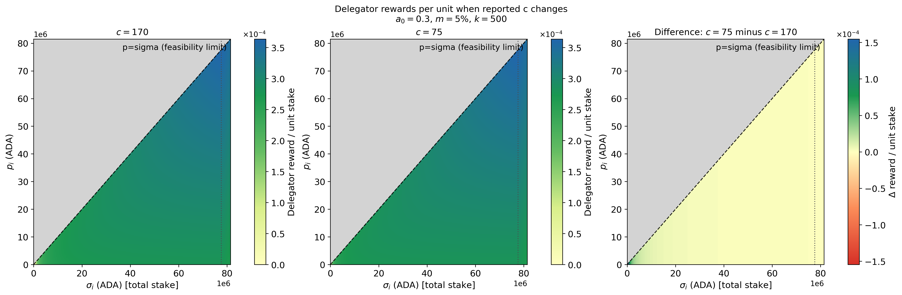

## Past evidence

On epoch $445$ there was a reduction of the `minPoolCost` from $340$ ADA to $170$ ADA. The analysis in this section illustrates the effects that the measure had on operators and delegators. Note that these observations do not imply that a new reduction will produce the same results, since market conditions may differ.

Key findings from this section:

1. Fee adjustment was limited: about $24.1%$ of Active pools reduced declared fixed cost, and about $4.5%$ reduced margin.
2. Gains were concentrated in reducers: among pools that reduced fixed cost, a majority gained stake ($52.5%$), and APR gains were stronger among reducers than in network-wide aggregates.
3. Combining fixed-cost and margin cuts was associated with better delegation outcomes than fixed-cost-only adjustments. Among cost reducers, raising margin ($22.3%$) was more common than also cutting it ($10.0%$).
4. Decentralization signals are mixed: reducers show net redistribution toward smaller pools, but whole-network concentration metrics moved in the opposite direction (Nakamoto $N$ from $190$ to $185$; Agg. active pledge from $1.58\text{B}$ to $1.39\text{B}$ ADA).
5. Operator viability weakened after cost adjustment (Cover OpEx from $827$ to $741$ pools).
6. Trade-off: after cost adjustment, operator viability declined while delegator APR improved modestly at the network level (median $3.03%$ to $3.04%$), with stronger APR gains among reducers (median $2.25%$ to $2.73%$).

### Aggregate system snapshot

The table summarizes the pool ecosystem before the reduction in `minPoolCost` (epoch $426$), at the reduction (epoch $445$), and after it (epoch $500$). Aggregate stake was stable. The number of pools fell by $1.6\%$ ($2,931$ to $2,884$); the Active set fell by $5.4\%$ ($1,516$ to $1,434$). Active pools hold essentially all stake at each snapshot.

| Epoch | Pools | Active pools | Total stake (B ADA) | Active stake (B ADA) |
|---:|---:|---:|---:|---:|
| 426 | 2,931 | 1,516 | 22.73 | 22.54 |
| 445 | 2,886 | 1,469 | 23.05 | 22.99 |
| 500 | 2,884 | 1,434 | 22.85 | 22.79 |

Active pools are the complement of Inactive. A pool is Inactive if $\sigma=0$, it fails to meet its declared pledge, or it produced zero blocks in the prior 15 epochs ($\approx 3$ months).

### Operators and delegators responses

The following plots and analysis show the response of operators and delegators to the reduction in `minPoolCost`. We have considered several epochs after the change to give players time to react.

> Note: The observations identified in the following analysis provide suggestive evidence rather than causal proof. Consequently, they do not imply that all observed changes resulted directly from the reduction in `minPoolCost`.

The next plot illustrates pool operator behavior following the reduction in `minPoolCost` between epochs $426$ and $500$. The sample is the $n = 1,251$ pools that were Active at both epochs. The left panel tracks changes in declared fixed costs; the right panel shows delegator and stake outcomes among the subset that lowered their fixed cost ($n = 301$).

$24.1\%$ of these Active pools ($301$) reduced their declared fixed cost. Among them, $59.1\%$ ($178$) expanded their delegator base and $52.5\%$ ($158$) increased their total stake. $75.5\%$ ($944$) kept the same declared cost, and six raised it. Most Active operators therefore left the fixed-cost lever unchanged. Among those that cut costs, a majority gained delegators and a slight majority gained stake.

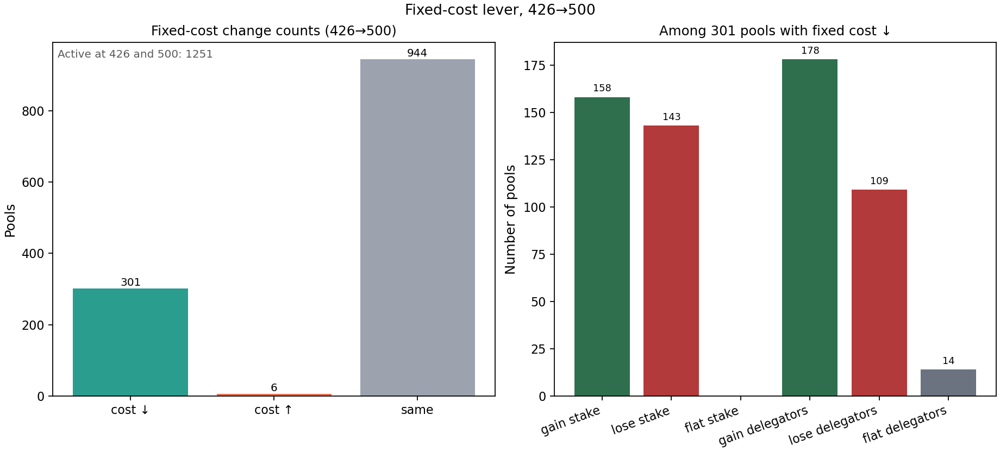

The next plot compares the baseline epoch $426$ characteristics between Active pools that reduced declared fixed cost ("Reducers", $n=301$) and those that did not ("Non-reducers", $n=950$). Reducers had lower median stake ($2.4\text{M}$ vs $8.1\text{M ADA}$) and higher median declared and active pledge ($100\text{k}$ vs $50\text{k ADA}$ declared; $104\text{k}$ vs $64\text{k ADA}$ active). Cost cuts therefore concentrated among smaller-stake Active pools that were more pledged, not among the largest pools.

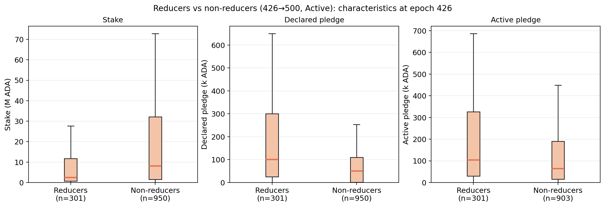

We next compare the baseline epoch $426$ characteristics between cost-reducing Active pools that gained total stake ("Gainers", $n=158$) and those that lost stake ("Losers", $n=143$). A striking divergence emerges in baseline delegation volume: Gainers were predominantly smaller pools, with a median stake of approximately $1.5\text{M ADA}$, whereas Losers held substantially higher baseline stake, with a median of $4.0\text{M ADA}$. In contrast, median declared and active pledge are similar in the two groups ($95\text{k}$ vs $100\text{k}$ ADA declared; $102\text{k}$ vs $107\text{k}$ ADA active). This suggests that reducing fixed costs was primarily effective for smaller pools where fee cuts yield a larger relative increase in delegator returns.

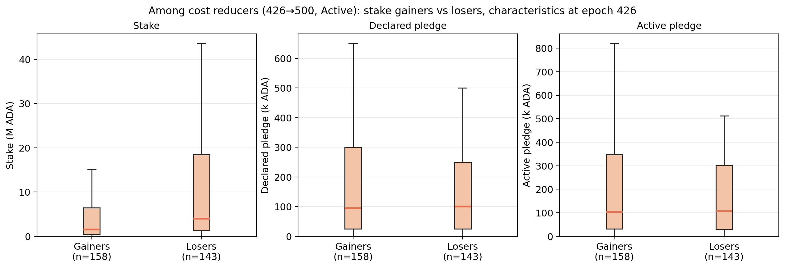

Beyond fixed-cost adjustments, operators could also alter their margin ($m_i$) to respond to changing market conditions. To investigate whether the reduction in `minPoolCost` catalyzed broader price competition across fee levers, the following analysis examines margin adjustments among the same $n = 1,251$ pools that were Active at both epochs $426$ and $500$. Margin cuts were rarer than fixed-cost cuts: only $4.5\%$ of these Active pools ($56$) reduced their margin, while $8.2\%$ ($102$) raised it and $87.4\%$ ($1,093$) left it unchanged. Among the $56$ pools that lowered their margin, $55.4\%$ ($31$) increased their total stake and $44.6\%$ ($25$) lost stake; the delegator count rose for $27$, fell for $27$, and was unchanged for $2$.

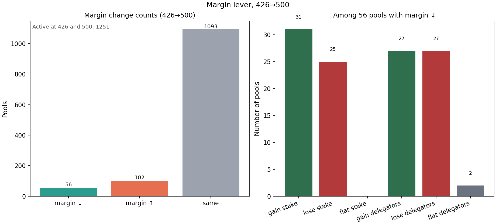

The following plot compares the baseline epoch $426$ characteristics across Active pool operators who reduced their margin ("Reducers", $n=56$), increased it ("Increasers", $n=102$), or kept it unchanged ("Same", $n=1,093$). Median stake differs sharply by margin decision. Reducers were smaller pools, with a median stake of $2.1\text{M ADA}$. Increasers and Same pools were larger and similar in scale ($6.9\text{M}$ and $6.5\text{M ADA}$). Increasers also had the highest median declared and active pledge ($100\text{k}$ and $107\text{k ADA}$). Reducers had the lowest median declared pledge ($44\text{k ADA}$); their median active pledge ($76\text{k ADA}$) lies between Same ($66\text{k ADA}$) and Increasers. Margin cuts therefore concentrated among smaller-stake pools, while the pools that raised margins were large and relatively high-pledged.

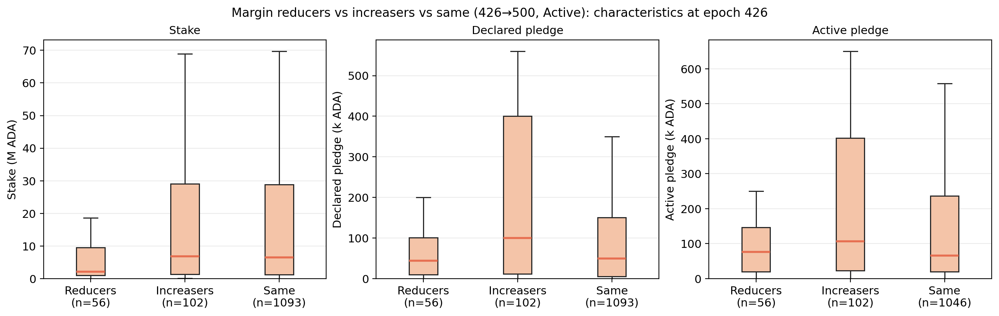

Next, we compare the baseline epoch $426$ characteristics between margin-reducing Active pools that gained total stake ("Gainers", $n=31$) and those that lost stake ("Losers", $n=25$). As with fixed-cost reducers, Gainers had lower median stake ($1.7\text{M ADA}$) than Losers ($2.2\text{M ADA}$). The gap is smaller than for cost cuts, but Losers have a longer upper tail (75th percentile $18.6\text{M}$ vs $6.4\text{M ADA}$). Median declared and active pledge are not the same: Gainers sit higher ($50\text{k}$ and $101\text{k ADA}$) than Losers ($20\text{k}$ and $57\text{k ADA}$), and Gainers also have a wider dispersion on both pledge measures. In this Active sample, margin cuts are associated with stake gains mainly among smaller-stake pools; larger pools in the upper tail still lost stake after lowering $m_i$.

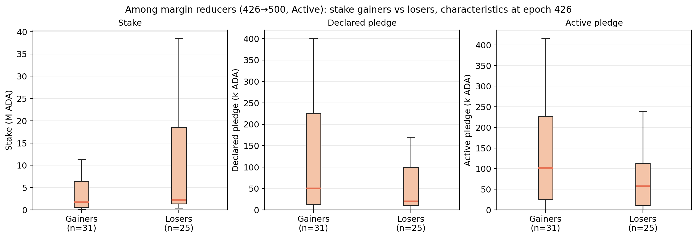

Having evaluated how pools responded to isolated fee adjustments, a natural follow-up question is whether operators coordinate both fee levers simultaneously. Specifically, does a reduction in fixed cost $c_i$ serve as a complement paired with a lower margin $m_i$ to maximize competitiveness, or as a substitute where operators raise $m_i$ to offset revenue lost from a lower $c_i$? The following analysis examines this interaction among the $n=301$ Active pools that reduced declared fixed cost between epochs $426$ and $500$: $10.0\%$ ($30$) also reduced their variable margin, whereas $22.3\%$ ($67$) increased it, leaving the remaining $67.8\%$ ($204$) with an unchanged margin. Among cost reducers, raising $m_i$ is therefore more common than cutting it; most leave the margin unchanged.

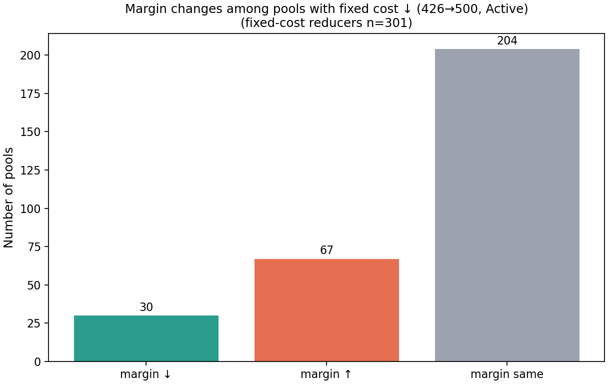

The last plot shows that pools combining both measures are more effective at attracting delegation.

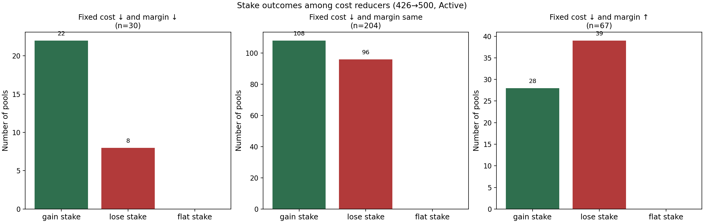

The next plot analyzes epoch $426$ stake, declared pledge, and active pledge across these same fixed-cost reducers ($n=301$), grouped by secondary margin strategy: also reduced margin ($n=30$), raised margin ($n=67$), or kept margin unchanged ($n=204$). Dual discounters were the smallest and least pledged group (median stake $2.0\text{M ADA}$; declared $31\text{k ADA}$; active $54\text{k ADA}$). Pools that cut cost and raised margin had the highest median stake ($3.3\text{M ADA}$) and a long upper tail (75th percentile $22.1\text{M ADA}$). Their median declared and active pledge ($100\text{k}$ and $110\text{k ADA}$) match the unchanged-margin group ($100\text{k}$ and $108\text{k ADA}$; median stake $2.3\text{M ADA}$). These patterns suggest that smaller pools relied on double fee cuts to build market presence, whereas larger pools leveraged fixed-cost reductions as a buffer to simultaneously raise margins.

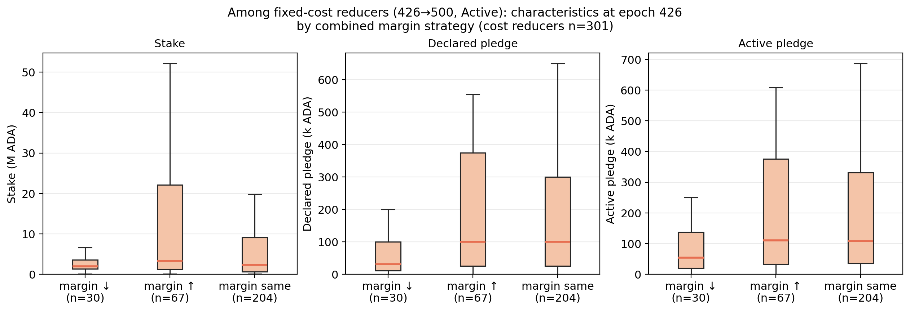

### Decentralization metrics

Next, we evaluate the impact of the `minPoolCost` reduction on network decentralization. We begin with the $n=301$ Active pools that reduced declared fixed cost between epochs $426$ and $500$, and measure net stake flows by initial stake at $426$. Net inflows concentrate in the two smallest bins: $+160\text{M ADA}$ in $0$–$1\text{M}$ and $+267\text{M ADA}$ in $1$–$5\text{M}$. The $15$–$30\text{M}$ bin has a net outflow of $-115\text{M ADA}$; $5$–$15\text{M}$ is slightly negative ($-24\text{M ADA}$) and $\ge 30\text{M}$ is slightly positive ($+12\text{M ADA}$). Among cost reducers, stake therefore moved toward smaller pools.

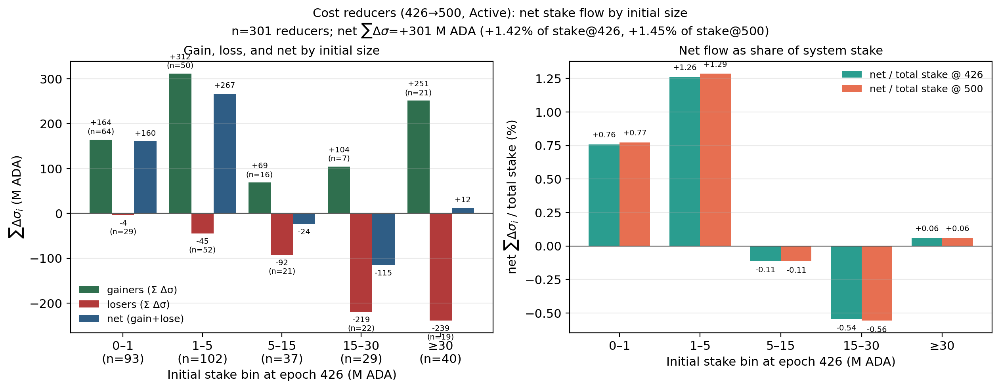

That plot is not whole-network causal proof: it covers only cost reducers. Among the $n=1,251$ pools Active at both epochs, $75.9\%$ ($950$) did not reduce declared cost and could have absorbed outflowing stake.

We next evaluate network decentralization on the Active set, using two metrics: the Nakamoto coefficient (the minimum number of pools controlling over $50\%$ of Active stake) and the aggregate pledge of that set. Ideally, this analysis should be conducted at the level of independent operators rather than individual pools. However, because the active pool count remains nearly stable between epochs 426 and 500, comparing the relative change in these coefficients across pools provides a reliable proxy for operator dynamics.

| Epoch | Nakamoto $N$ | Active pools | Aggregate stake of $N$ | Total Active stake | Share | Agg. declared pledge | Agg. active pledge |
|------:|---------------:|---------------:|-------------------------:|-------------------:|------:|------------------------:|----------------------:|
| 426 | 190 | 1,516 | 11.28B ADA | 22.54B ADA | 50.05% | 1.44B ADA | 1.58B ADA |
| 500 | 185 | 1,434 | 11.41B ADA | 22.79B ADA | 50.04% | 1.28B ADA | 1.39B ADA |

Over epochs $426$ to $500$, the Nakamoto coefficient falls by $2.6\%$ ($190$ to $185$ pools). The economic commitment of that controlling set falls by more: minimum aggregate declared pledge is down $11.2\%$ ($1.44\text{B}$ to $1.28\text{B ADA}$), and minimum aggregate active pledge is down $12.2\%$ ($1.58\text{B}$ to $1.39\text{B ADA}$). These findings indicate that, in the time window considered, stake concentration not only consolidated into slightly fewer pools, but the controlling pools themselves operated with less "skin in the game," marking an increase in network centralization. 

### Pools viability

We recompute operator rewards $\Pi_i$ for a fixed cohort of pools that were Active at both epoch $426$ and epoch $500$, holding each pool’s epoch-$426$ stake $\sigma_i$, declared pledge $p_i$, active pledge $\hat p_i$, and margin $m_i$ fixed. Gross pool reward $f(\sigma_i,p_i)$ is computed once under $k=500$, using $T=36.01B$ ADA, $R=21.6M$ ADA, and $a_0=0.3$ (which are the parameters value for epoch 426). We then compare viability under each pool’s declared fixed cost at epoch $426$ (when $`minPoolCost`=340$) versus its declared fixed cost at epoch $500$ (when $`minPoolCost`=170$). This allows us to compare pool viability before and after the parameter change while isolating operator fee responses. By holding delegation and other market variables constant, we focus exclusively on how the same pool cohort adjusted its declared fixed cost in response to the `minPoolCost` reduction.

With monthly OpEx of $667$ USD (see [Lopez de Lara (2026)](https://input-output-hk.github.io/spo-incentives/pdf-viewer.html?file=references/previous-analasys/spo-incentives-analysis_lopez-de-lara_2025.pdf))) and ADA at $0.31$ USD,

$$C^*=\frac{667/6}{0.31}=358.6 \text{ ADA per epoch}.$$

Let $r=\Pi_i/C^\*$. Among $1,204$ pools with theoretical reward, $827$ cover $C^\*$ under epoch-$426$ costs, of which $480$ are on the edge ($1\le r<2$). Under the same delegation but with epoch $500$ declared costs, $741$ remain viable. The Edge group falls from $480$ to $403$, while Strong ($r\ge 5$) is unchanged at $96$.

After the change in `minPoolCost`, in this $1,204$-pool cohort, $307$ changed cost ($301$ decreases, $6$ increases), including $264$ direct $340$-to-$170$ changes.

| | Epoch-426 costs (minPoolCost 340) | Epoch-500 costs (minPoolCost 170) | Variation |
| :--- | ---: | ---: | ---: |
| Pools | 1,204 | 1,204 | — |
| Cover OpEx ($r\ge 1$) | 827 | 741 | −10.4% |
| Losing ($r<1$) | 377 | 463 | +22.8% |
| Edge ($1\le r<2$) | 480 | 403 | −16.0% |
| Comfortable ($2\le r<5$) | 251 | 242 | −3.6% |
| Strong ($r\ge 5$) | 96 | 96 | 0.0% |

The plot shows a moderate reduction in operator viability from the historical cost cuts, before any redelegation.

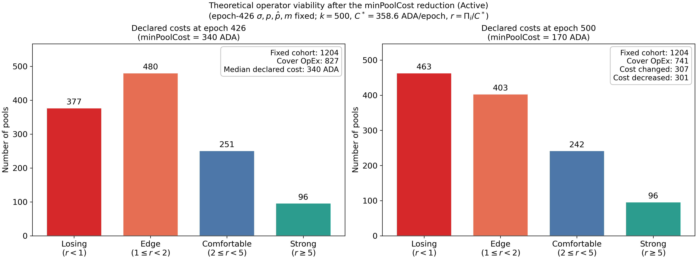

### APR

To evaluate how the reduction in `minPoolCost` affects delegator returns, we calculate the annualized delegator yield:

$$\text{APR}_i \approx 73(1-m_i)\frac{\max\{f(\sigma_i,p_i)-c_i,0\}}{\sigma_i}$$

This measures the net yield per ADA after accounting for fixed costs ($c_i$) and variable margins ($m_i$). APR summary statistics in this subsection are computed over pools with positive delegator return, that is, pools satisfying $f(\sigma_i,p_i)>c_i$. Calculations are based on the Active epoch $426$ snapshot with parameters $T=36.01\text{B ADA}$, $R=21.6\text{M ADA}$, $a_0=0.3$, and $k=500$. Of the $1,516$ Active pools with complete baseline data, $1,251$ remain Active at epoch $500$, while $265$ leave the Active set.

For the counterfactual scenario, pools that remain Active hold their epoch $426$ stake, pledge, and margin fixed while adopting their actual epoch $500$ declared fixed costs. This isolates operators' fixed-cost response effects on APR. Pools that leave the Active set are retained in the epoch $426$ baseline to prevent survivorship bias, but are excluded from the cost-adjusted scenario.

| Sample and scenario | Pools | Median APR | Mean APR |
| :--- | ---: | ---: | ---: |
| Epoch-426 costs: all Active pools | $1,516$ | $2.99\%$ | $2.56\%$ |
| Epoch-426 costs: leave Active set by epoch $500$ | $265$ | $2.53\%$ | $2.20\%$ |
| Epoch-426 costs: remain Active | $1{,}251$ | $3.03\%$ | $2.60\%$ |
| Epoch-500 costs: remain Active (cost-adjusted) | $1,251$ | $3.04\%$ | $2.64\%$ |

Fixed-cost reductions led to a slight increase in positive delegator APRs (median rising from $3.03\%$ to $3.04\%$). Only $301$ of the $1,251$ continuing Active pools lowered $c_i$, so the network-wide median yield movement remains modest. Although individual pools that cut their fixed costs may have enhanced their competitive standing, these adjustments were insufficient to materially alter median attractiveness in the Active set.

The next plot compares the APR distribution for the epoch $426$ Active cohort under baseline costs versus cost-adjusted costs. It shows a mild upward shift in the distribution after cost adjustment, consistent with the small increase observed in the median and mean APR statistics.

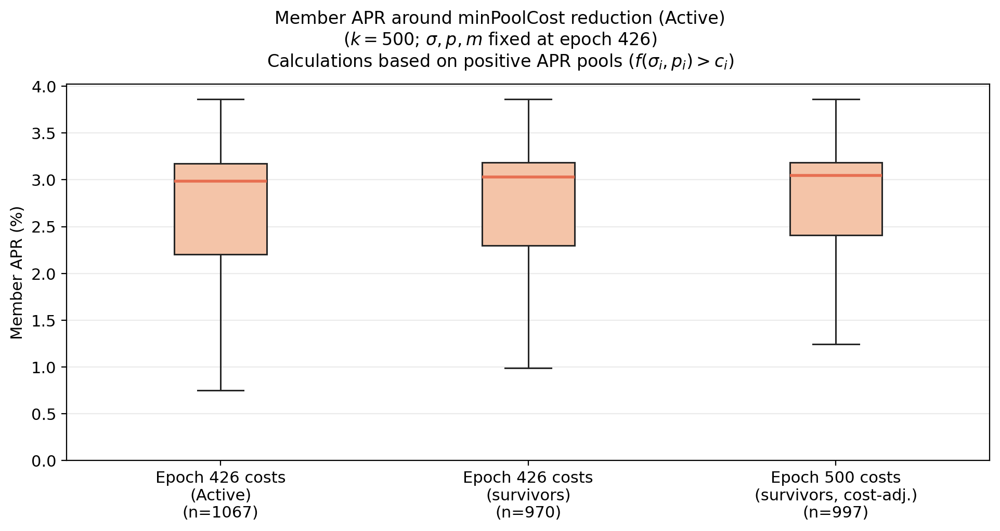

The following plot isolates the $301$ continuing Active pools that reduced their fixed costs, demonstrating the resulting increase in APR and their enhanced competitiveness. Median APR rises from $2.25\%$ to $2.73\%$, and the number of pools with positive return rises from $219$ to $247$.

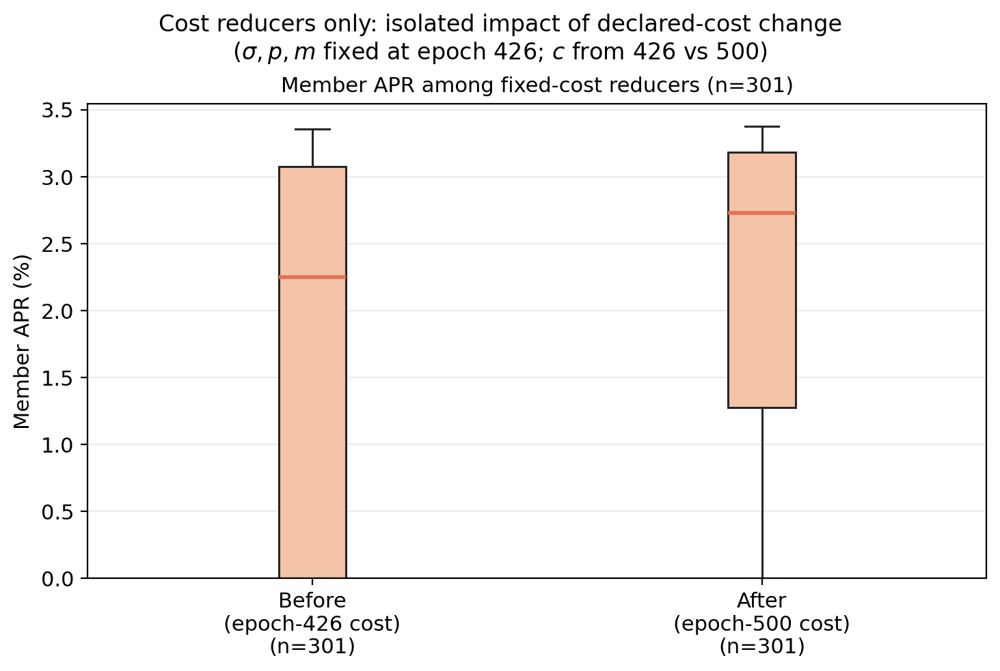

## Behavioral and equilibrium effects

This section outlines potential behavioral and second-order effects—focusing on delegator and operator decisions based on data through epoch 644.

Changing $c_{min}$ does not modify gross rewards $f(\sigma_i,p_i)$ directly, but it changes feasible declared costs $c_i$, which feed into pool desirability, operator revenue, and participation constraints. 

### Rational behavior

In [Brünjes et al. (2020)](https://arxiv.org/pdf/1807.11218), `minPoolCost` ($c_{\min}$) is not a parameter of the theoretical model. The paper initially treats costs as publicly known. Later, it allows an operator to declare a cost $c_i$ different from its true cost $\hat c_i$, and argues that truthful declaration is a dominant strategy under the assumption that players end up at a perfect equilibrium.

If operators declare their true costs whenever permitted, and otherwise declare the minimum allowed cost, lowering `minPoolCost` would allow all pools with $\hat c_i<c_{\min}^{original}$ to reduce their declarations to $\max(\hat c_i,c_{\min}^{new})$. Other pools could also be affected if operators adjust their margins or delegators move their stake in response. Given $k$, the paper describes an idealized equilibrium with $k$ pools of equal size, each holding $1/k$ of the total stake. This suggests that lowering the minimum cost could change which operators run the pools and the margins they charge, without necessarily changing the number or size of pools. However, because the paper does not directly examine `minPoolCost`, this remains a possible outcome rather than a firm prediction.

#### Delegators moving stake

Consider delegators that allocate by expected net return per unit stake, ranking pools based on their desirability. Suppose $f(\sigma_i, p_i)>c_i$, where $c_i$ is the declared fixed cost (when $f(\sigma_i, p_i)<c_i$, the protocol does not distribute rewards to delegators). The operator declares their actual cost whenever it is greater than or equal to $c_{min}$. Otherwise, the operator declares $c_{min}$. That is, $c_i = \max \\{ \hat{c}\_i, c_{min}\\}$. Then

$$
D_i(c_i)=
\begin{cases}
(1-m_i)\frac{f(\sigma_i, p_i)-\hat{c}\_i}{\sigma_i}, & \quad \text{if } \quad \hat{c}_i \geq c_{min},\\
(1-m_i)\frac{f(\sigma_i, p_i)-c_{min}}{\sigma_i}, & \quad \text{if } \quad \hat{c}\_i < c_{min}.
\end{cases}
$$

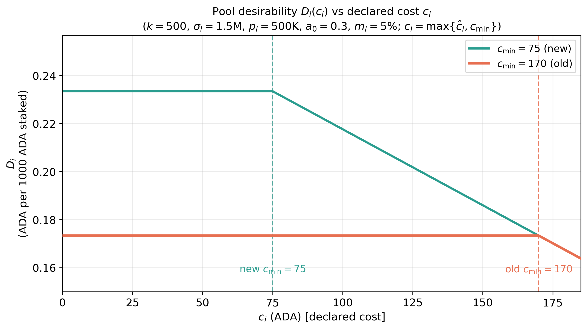

A reduction in $c_{min}$ allows certain pools to declare their actual costs rather than being constrained by the fee floor. This increases the net rewards, $f(\sigma_i, p_i) - c_i$, distributed to delegators, which could induce a shift of stake toward those pools reducing their declared cost.

<!-- Can we here see what happens with the desirability using actual data? We could have a plot of current desirability versus stake, and see how desirability changes if all pools change their declared cost -->

#### Operators changing pledge, margin, or declared fixed cost

The operator utility is

$$
U_i=\Pi_i-\hat c_i,
\qquad
\Pi_i=c_i+(f(\sigma_i,p_i)-c_i)\left[m_i+(1-m_i)\frac{\hat p_i}{\sigma_i}\right],
$$

where $\hat c_i$ is the actual operating cost and $c_i$ the declared cost. Following [Brünjes et al. (2020)](../../References/papers/reward-sharing-schemes_brunjes-kiayias-et-al_2020.pdf), operators should declare their actual cost (unless this declaration is constrained by `minPoolCost`). However, actual data shows a behavior that differs from what is theoretically predicted. The [histogram](#fig-min-pool-cost-644) shows clusters around declared costs of $340$ ADA and $170$ ADA. Moreover, once `minPoolCost` was reduced in the past (from $340$ ADA to $170$ ADA), many pools preferred to stay with $c_i = 340$ ADA instead of reducing it to $170$ ADA. Both aspects suggest that not all pools may be declaring their actual costs.

When `minPoolCost` is lowered, some operators may use a lower $c_i$ to become more competitive and gain delegation. However, we already pointed out that a potential consequence of reducing $c_{min}$ is that very small pool operators may not have room to reduce their fixed costs without losing economic viability. The next plot shows the $n=558$ Active pools with declared $c_i=340$ ADA that get a reward during epoch $644$ (i.e., they produced a block). The plot shows how much reward (in percentage) these operators would lose if they report $170$ ADA instead of $340$ ADA. The figures are considerable and may prevent those pools from declaring a lower fixed cost. Note that in the first bin there are $89$ pools: $64$ of them lose exactly $0\%$ because they all have a margin $m_i=100\%$, while $25$ losses belong to the range $(0,2.5\%)$.

  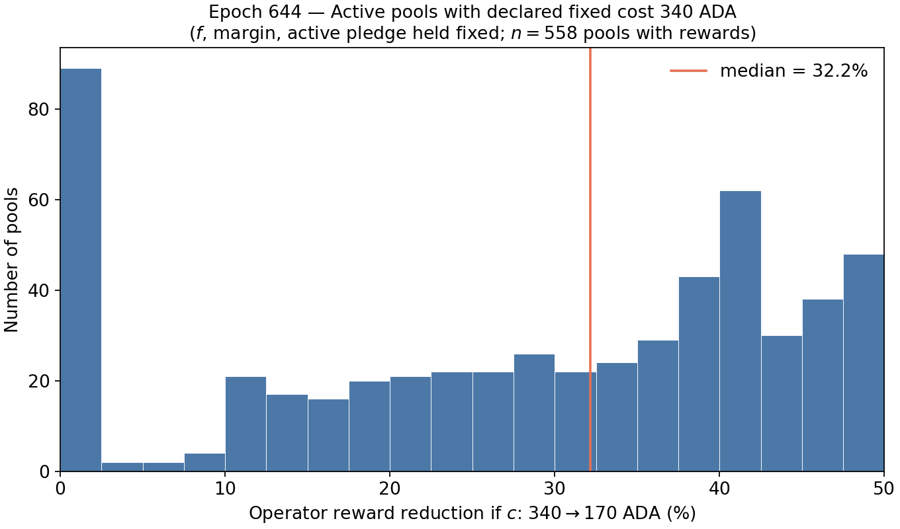

The subsequent plot shows that Active pools with the lowest feasible fixed cost ($170$ ADA) tend to be smaller than those retaining $340$ ADA. Median stake is $1.63$M ADA at $170$ ADA versus $7.56$M ADA at $340$ ADA. The size difference appears further up the distribution: $41\%$ of $170$ ADA pools have less than $1$M ADA, compared with $23\%$ of $340$ ADA pools, while $45\%$ of $340$ ADA pools exceed $10$M ADA versus $27\%$ at $170$ ADA. One possible explanation is that delegators consider factors such as reputation and established relationships alongside expected rewards, so a lower fixed cost alone may not be enough to attract more stake. Some large pools retaining a fixed cost of $340$ ADA may also be operated by centralized exchanges (CEXs) that controlls their delegations. These remain possible explanations, since the plot alone cannot establish what drives the observed size differences.

  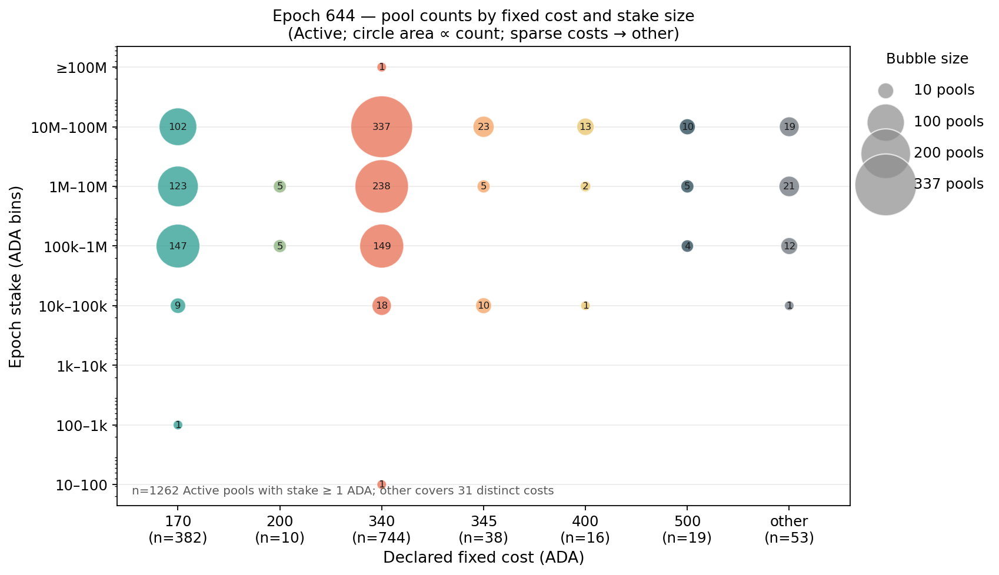

Theoretically, a lower $c_{min}$ leads to lower equilibrium margins $m_i$, intensifying competition among pool operators. However, as shown in the next plot, this price competition is mainly observed among pools declaring $c_i=170$ ADA: $41\%$ of them set $m_i$ in $0$–$1\%$, and the median margin is $1\%$. In contrast, among pools retaining $340$ ADA the median margin is $2\%$, only $21\%$ sit in the $0$–$1\%$ bin, and $66$ pools ($9\%$) charge $m_i=100\%$, compared with $14$ pools ($4\%$) at $170$ ADA.

  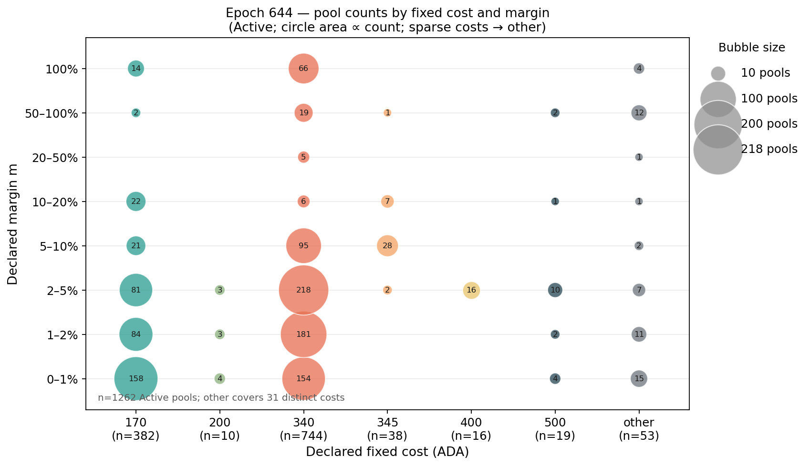

#### Entry or exit of pools

Entry or exit can be analyzed with the participation constraint, which needs to take into account the actual fixed costs $\hat c_i$ and opportunity costs (or outside options). Let

$$
U_i=\Pi_i-\hat c_i,
\qquad
\Pi_i=c_i+(f(\sigma_i,p_i)-c_i)\left[m_i+(1-m_i)\frac{\hat p_i}{\sigma_i}\right],
\qquad
s_i\equiv m_i+(1-m_i)\frac{\hat p_i}{\sigma_i}\in[0,1].
$$

It follows that a pool decides to participate when

$$U_i\ge \underline{U}_i \iff f_i\ge f_i^{\star} \equiv \frac{\underline{U}_i+\hat c_i-(1-s_i)c_i}{s_i},
$$

where $\underline{U}_i$ denotes the outside option. For simplicity, let's assume $\underline{U}_i=0$.

Notice that if there is truthful cost reporting ($c_i=\hat c_i$), then the previous condition becomes $f_i\ge c_i$. However, we have already argued that the data do not suggest truthful reporting.

Using actual data from epoch $644$, the following chart shows how many pools during that epoch are at viability risk (note that using only one epoch as a data source may not represent the actual situation of those pools). For each pool we calculate its

$$
\Pi_i=
\begin{cases}
f_i, & f_i\le c_i,\\
c_i+(f_i-c_i)\left[m_i+(1-m_i)\dfrac{\hat{p}_i}{\sigma_i}\right], & f_i>c_i,
\end{cases}
$$

using their margin, delegation, active and declared pledge, and declared fixed cost. We consider the case in which the latter is not the actual operating cost that the pools face. In particular, we assume that all pools have the same operation cost/expenditure ($C^*$) equal to $667$ USD per month or six epochs (see [Lopez de Lara (2026)](https://input-output-hk.github.io/spo-incentives/pdf-viewer.html?file=references/previous-analasys/spo-incentives-analysis_lopez-de-lara_2025.pdf))), and a token price of $0.15 USD/ADA$ giving 

$$C^*=667/6/0.15=741.1 \text{ USD per epoch}.$$

The plot measures $r=\Pi_i/C^\*$, where any $r<1$ indicates not enough rewards to cover costs. Among $1262$ Active pools, only $274$ would be able to cover the OpEx $C^\*$. However, $149$ of them would be on a risky situation ($1\leq r<2$).

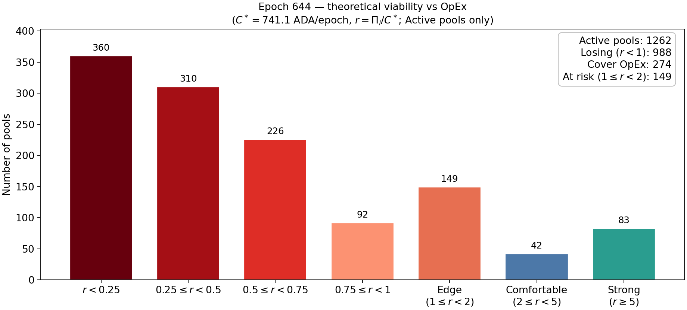

Note that the low ADA price has a direct implication in the previous results. However, the first bin ($r<0.25$) would need a very large increment in the price to cover their costs. The next chart shows the characteristics of each group.

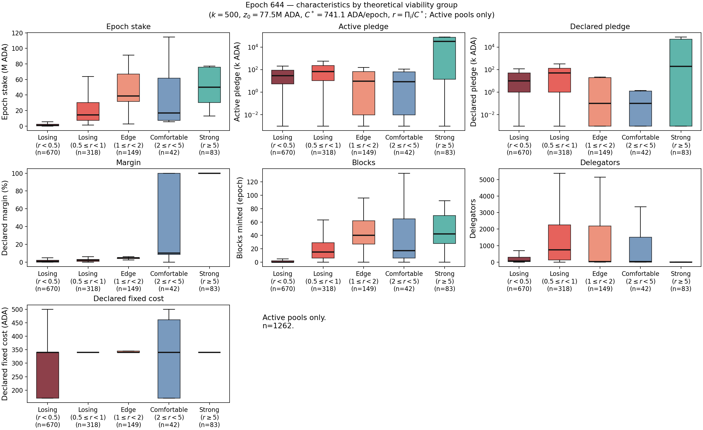

| | Losing $r<0.5$ (n=670) | Losing $0.5\leq r<1$ (n=318) | Edge (n=149) | Comfortable+Strong (n=125) |
|---|---:|---:|---:|---:|
| Epoch stake (M ADA), median | 0.82 | 14.36 | 38.62 | 39.39 |
| Active pledge (k ADA), median | 29.8 | 67.1 | 9.3 | 312.5 |
| Declared pledge (k ADA), median | 10.0 | 50.0 | 0.1 | 10.0 |
| Declared fixed cost (ADA), median | 340 | 340 | 340 | 340 |
| Margin (%), median | 1.0 | 2.0 | 5.0 | 100.0 |
| Theoretical operator reward (ADA), median | 179 | 460 | 925 | 8,723 |
| Coverage ratio $r$, median | 0.242 | 0.621 | 1.249 | 11.770 |

Pools with $r<0.5$ have median stake $\approx 0.82$M ADA and median operator reward $\approx 179$ ADA, whereas those with $0.5\leq r<1$ already look like mid-sized pools (median stake $\approx 14.4$M ADA)—still well below Edge on stake, but often with higher active and declared pledge than Edge. Across all groups, the median declared fixed cost remains anchored at $340$ ADA despite `minPoolCost` $=170$ ADA. Lower margins $m_i$ among losing pools do not close the gap: desirability is driven more by existing delegation volume than by $m_i$ cuts alone.

#### Pool splitting by multi-pool operators

A reduction in $c_{min}$ can affect the incentive to split one pool into multiple pools through opposing channels. On one side, splitting can increase operator revenue when fixed cost is collected per pool. On the other side, splitting also fragments stake and pledge across child pools, which can reduce their desirability and make delegation harder to retain.

Pool desirability is

$$
D_i=(1-m_i)\frac{f(\sigma_i,p_i)-c_{min}}{\sigma_i},
$$

a lower $c_{min}$ improves the relative attractiveness of smaller pools by reducing the fixed-cost drag on delegator return. This tends to reduce the fixed-cost disadvantage of newly created split pools and may help them attract delegation. At the same time, the operator must divide pledge and existing stake across the split, but delegator reallocation may not be fully under operator control.

Thus, reducing $c_{min}$ has an ambiguous overall effect on multi-pool operation: it weakens the fixed-cost duplication gain from splitting, while making smaller post-split pools more competitive for delegation. Which effect dominates depends on operating costs, margins, pledge allocation, and realized delegation responses.

We illustrate this ambiguity with a simple exercise. For each pool we compute the theoretical

$$
\Pi_i = c_i + (f_i-c_i)\bigl[m_i+(1-m_i)\hat p_i/\sigma_i\bigr]
\quad\text{if }f_i>c_i,\quad
\Pi_i=f_i\text{ otherwise},
$$

with $f_i=f(\sigma_i,p_i)$ and $f_i=0$ if active pledge is below declared pledge.

Suppose each pool becomes two halves with

$$
\sigma'=\sigma_i/2,\quad p'=p_i/2,\quad \hat p'=\hat p_i/2,\quad
\text{same }m_i\text{ and declared }c\text{ in each half}.
$$

We then compare the unsplit reward $\Pi_i$ with the split outcome $\Pi'+\Pi'=2\Pi(\sigma',p',\hat p',c_i,m_i)$.

*Scenario A — original declared fixed costs*

| Outcome | Active pools | Median $\Delta\Pi$ | Mean $\Delta\Pi$ |
|---|---:|---:|---:|
| $\Pi$ increases after split | 840 (66.6%) | $319.89$ | $248.53$ |
| $\Pi$ decreases after split | 383 (30.3%) | $-0.00$ | $-282.43$ |
| Unchanged | 39 (3.1%) | $0.00$ | $0.00$ |

Under this scenario with the original declared costs, a $1\to 2$ split increases operator reward for a majority of Active pools ($66.6\%$ increase vs $30.3\%$ decrease).

Among decreasers the median $\Delta\Pi=\Pi_{\mathrm{split}}-\Pi_{\mathrm{unsplit}}$ is essentially $0$ ($-0.003$ ADA); the mean ($-282$) is a left tail. That is, most of the $30.3\%$ “losses” are negligible and reading the “$30.3\%$ decrease” in isolation would overstate how many operators actually lose a material amount. Increasers are the opposite: median $+320$ ADA, mean $+249$ ADA. Regarding the overall statistic: median $\Delta\Pi=162.74$ ADA/epoch; mean $79.71$.

Next plot shows that gainers are much larger (median stake $10.45$M ADA vs $0.40$M ADA), while median active pledge is similar in both groups.

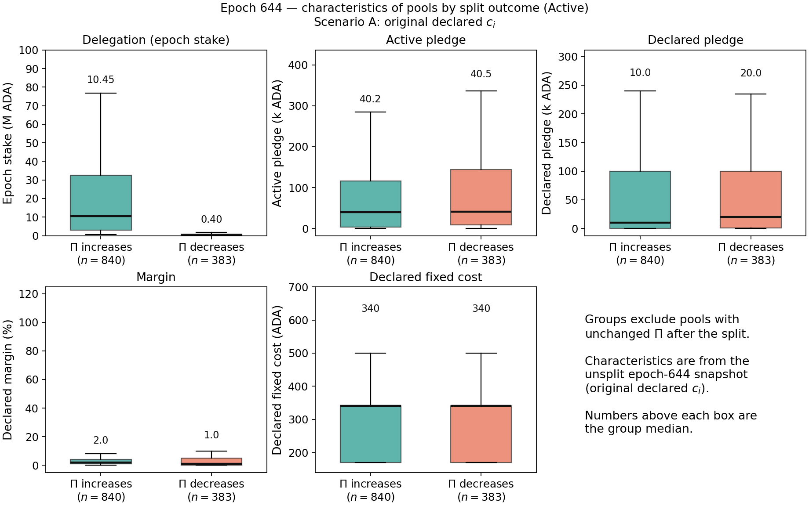

*Scenario B — declared fixed cost cut 50% before and after the split*

Both the unsplit pool and each half use $c'=c_i/2$.

| Outcome | Active pools | Median $\Delta\Pi$ | Mean $\Delta\Pi$ |
|---|---:|---:|---:|
| $\Pi$ increases after split | 946 (75.0%) | $157.61$ | $125.80$ |
| $\Pi$ decreases after split | 281 (22.3%) | $-0.00$ | $-385.74$ |
| Unchanged | 35 (2.8%) | $0.00$ | $0.00$ |

Median $\Delta\Pi$: $83.47$ ADA/epoch; mean: $8.41$ ADA/epoch.

When declared fixed cost is cut by half, both before and after the split, the fraction of Active pools gaining is larger than in Scenario A ($75.0\%$ vs $66.6\%$), and the fraction losing decreases ($22.3\%$ vs $30.3\%$). The mean $\Delta\Pi$ falls sharply ($79.71 \to 8.41$ ADA/epoch), consistent with a weaker fixed-cost duplication gain when $c$ is already lower. Again, gainers are larger (median stake $7.19$M ADA vs $0.27$M ADA), but the median size required to become a gainer decreases relative to Scenario A ($10.45$M to $7.19$M ADA). As in Scenario A, most recorded decreases are negligible (median $\Delta\Pi \approx 0$); the negative mean is a left tail.

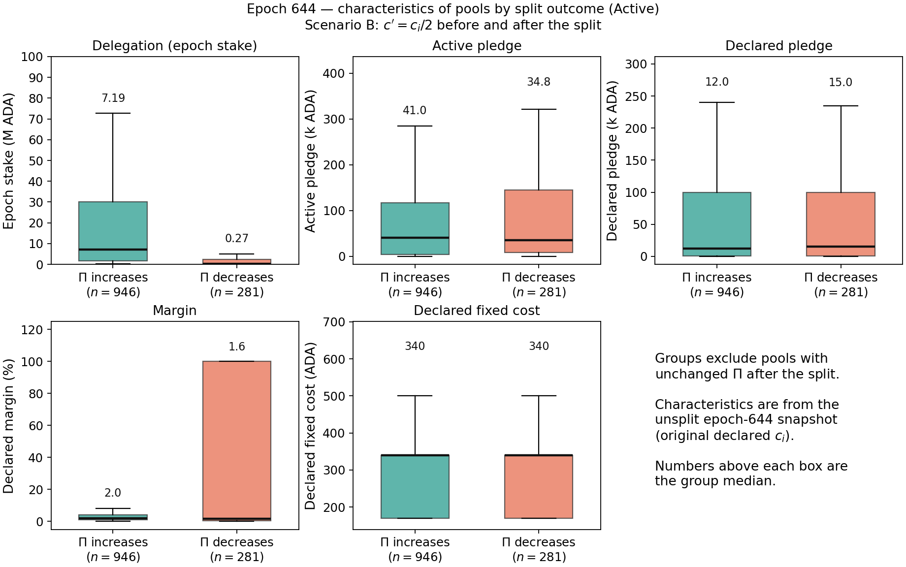

#### Changes in staking participation

Changes in staking participation are closely tied to shifts in delegator APR, although external factors such as market sentiment and alternative investment opportunities also matter. Past data from the previous minPoolCost reduction shows that pools, particularly smaller ones, that lowered declared fixed costs tended to improve both APR and stake. However, neither network-wide median APR nor total aggregate stake changed materially. This pattern is consistent with limited fee adjustment by operators and with redelegation across existing pools rather than large net new inflows into staking.

To quantify the potential APR channel under broader fee adjustment, the next table and plot report a counterfactual in which all Active pools are assigned the same declared fixed cost level ($c_i=170$, $75$, or $25$ ADA), and outcomes are compared against baseline. The column $f>c$ tracks pools with positive delegator return (that is, pools satisfying $f(\sigma_i,p_i)>c_i$).

| Scenario | $f>c$ | Change | Mean APR | Change | Median APR | Change | Losing ($r<1$) $C^*=741.1$ | Change |
|---|---:|---:|---:|---:|---:|---:|---:|---:|
| Baseline | 927 | — | 1.47% | — | 1.83% | — | 988 | — |
| $c_i=170$ | 999 | +7.8% | 1.51% | +3.2% | 1.90% | +3.7% | 1046 | +5.9% |
| $c_i=75$ | 1118 | +20.6% | 1.61% | +9.7% | 1.96% | +7.4% | 1070 | +8.3% |
| $c_i=25$ | 1228 | +32.5% | 1.72% | +17.6% | 2.04% | +11.5% | 1078 | +9.1% |

The table indicates a monotonic increase in delegator APR as declared fixed costs are lowered uniformly. At the same time, the count of losing operators ($r<1$) increases, reflecting the trade-off between stronger delegator returns (before any response of delegators and operators to the change in declared $c_i$) and weaker operator-side viability under lower fixed costs.

The plot visualizes the same counterfactual shift in APR distribution and confirms that the gain is broad but moderate at $c_i=170$, becoming progressively stronger at lower cost levels.

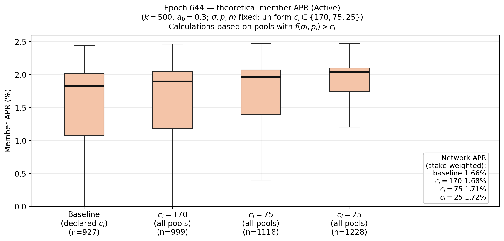

## Interaction effects (ToDo)

See the file analysis in the [interaction effects file](../Interaction-effects/interaction_effects.md)

